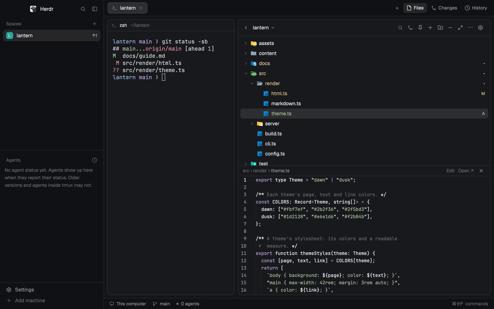
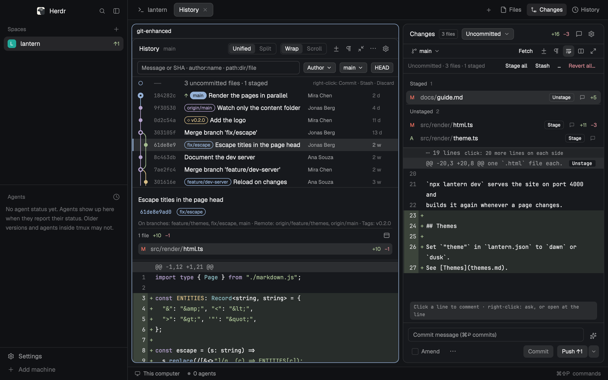
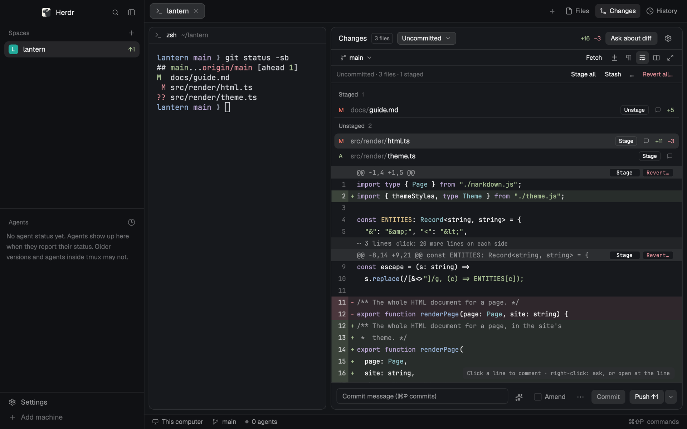

# Herdr Enhanced

A better side panel for the [Herdr](https://herdr.dev) app: two mods built on the Files and Changes
panels that ship with it, and a layout with both. Each mod works alone, in the layout you use now or
in a window of its own.

<p>
  <a href="files-enhanced/"></a>
  <a href="git-enhanced/"></a>
  <a href="herdr-enhanced/"></a>
</p>

From left to right: [Files Enhanced](files-enhanced/), a folder's tree with git marks and a file's
preview; [Git Enhanced](git-enhanced/), History in a tab of its own and the panel beside it on
Changes; [Herdr Enhanced](herdr-enhanced/), Herdr's window with its side panel on Changes.

- **[Files Enhanced](files-enhanced/)**, a mod: a file browser for the folder your focused terminal
  is in. A tree with git marks, a preview that edits, search in file names and contents, a
  right-click menu with dialogs, several selected rows and a file clipboard.
- **[Git Enhanced](git-enhanced/)**, a mod: the panel's Changes and History pages for the focused
  terminal's repository. Staging files, hunks and lines, committing (an agent can write the
  message), pushing, branches, stashes, conflicts, undo, comments on diff lines sent to the space's
  agent, the commit graph with menus down to an interactive rebase, and a record of what each agent
  turn changed.
- **[Herdr Enhanced](herdr-enhanced/)**, a layout: Herdr's own window with a History button on its
  tab bar and both mods as its panel's Files, Changes and History pages.

Both mods work the same in a space on another machine (one added with `hc machine add`) as on this
computer. With both installed, each links to the other: a file in Files Enhanced has Show changes
and File history, a file in Git Enhanced has Show in Files. They share one settings window: each
mod's own page, and the Open with and Agents pages both use.

## Install

In Herdr, ask your agent:

```text
Read ~/.config/herdr-app/AGENTS.md, then add this mod: https://github.com/chaofanma/herdr-enhanced/tree/master/files-enhanced
```

Or `https://github.com/chaofanma/herdr-enhanced/tree/master/git-enhanced`, or the whole layout:
`https://github.com/chaofanma/herdr-enhanced/tree/master/herdr-enhanced`. The agent reads every file
first and tells you what the mod runs. To do it by hand, each entry's README says how: copy its
folder into `~/.config/herdr-app/mods/` (the layout's files into `layouts/` too), run
`herdr-app check`, then put the mod in your layout or open it in a window of its own.

Their pages in Herdr's gallery: herdr.dev/mods/chaofanma/herdr-enhanced--files-enhanced,
herdr.dev/mods/chaofanma/herdr-enhanced--git-enhanced and
herdr.dev/layouts/chaofanma/herdr-enhanced--herdr-enhanced.

Before you install: both mods run programs (`sh`, `git`, `find` and more, on this computer or on the
space's machine; each README lists them), and Git Enhanced's pen sends your diff to the agent you
pick, which sends it on to its model provider.

To update, copy the new folders over the old ones: Herdr reloads a mod whose files changed.

## For other mods

Either mod shows a file or a change when another mod asks it through a shared key,
`files-enhanced.reveal` or `git-enhanced.reveal`: their READMEs say how.

## Develop

```sh
node --test test/*/*.test.mjs          # every test
herdr-app check files-enhanced/mods/files-enhanced
herdr-app check git-enhanced/mods/git-enhanced
herdr-app check herdr-enhanced/mods/tabs-enhanced
node tools/check-variants.mjs          # what herdr-app check can't reach with empty props: dialogs,
                                       # menus, page states, the tab header, the settings window
tools/check-shared.sh                  # each mod's copies of shared/*.js are unchanged
tools/check-copies.sh                  # herdr-enhanced/mods/ holds both mods unchanged
tools/check-upstream.sh                # Herdr's own tab bar is still the one the layout's copies
```

An entry folder holds only what goes into Herdr and its docs, since an agent installing a mod reads
every file there: the tests are in `test/` (a folder per entry, and `test/shared/`), the tools in
`tools/`. `shared/` holds the originals of the modules both mods copy unchanged, each file's first
line saying what it does: change one there only, then run `node tools/copy-shared.mjs`. Change a mod
in its own entry only, then run `node tools/make-entry.mjs` for the layout's copies in
`herdr-enhanced/mods/`. A shared module may import the other shared modules and its mod's `./id.js`.
`tools/make-icons.mjs` makes Files Enhanced's icons from a checkout of Material Icon Theme.

The tests render the mods with stubbed Herdr modules, which refuse `cx.notify()` and `setShared()`
while a view renders, and check each rendered tree for layouts that fail on screen. They run the
mods' scripts and git for real in temporary folders, also as if on another machine, but start no
other program and never touch the repository they are started from.

## License

Apache-2.0 ([LICENSE](LICENSE)). Based on the Files, Changes, menu, prompt, confirm and tabs mods
and the main layout that ship with Herdr (Apache-2.0), changed: see [NOTICE](NOTICE). Code adapted
from VS Code, Material Icon Theme, lazygit, Cline and shell-words, and the Lucide icons:
[THIRD_PARTY_NOTICES.md](THIRD_PARTY_NOTICES.md).
