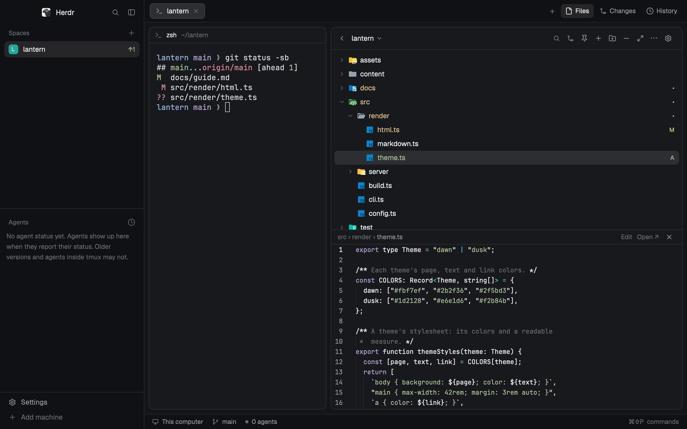

# Files Enhanced

A file browser for Herdr's side panel. It shows the folder of the terminal you're working in as a
tree with git marks and file icons, previews and edits files under it, searches file names and
contents, and has a right-click menu for what you do with files. In a space on another machine it
works the same. It is a mod for the [Herdr](https://herdr.dev) app, built on the Files panel that
ships with it; [Git Enhanced](../git-enhanced/README.md) does the same for the panel's Changes and
History pages.



## What it does

- **Follows you.** The tree shows the focused terminal's folder and follows it across panes, tabs
  and spaces. Each folder remembers which subfolders were open, the previewed file and the
  selection. Pin a folder for the space (the pin button), go up a level (`‹`, which pins the
  folder above), or pick a recent folder from the folder name's popup.
- **Git marks** from the repository the folder is in and those nested in it (down to the depth set
  in the settings): modified files yellow `M`, new ones green `A`, deleted or conflicted ones red
  `D` / `U`, a dot on folders with changes inside, the branch next to each nested repository's
  folder, and an accent dot on changed files modified in the last 10 minutes. The **Changed** view
  (the button with Herdr's changes icon) lists the changed files newest first, with their age.
- **Preview** below the tree: code with syntax colors, Markdown rendered (or its source), images.
  The path above it is a breadcrumb: a click on a folder in it shows that folder in the tree.
- **⤢** opens the shown folder in a tab of its own, the panel making room: the tree at the left
  and the preview at the right, the line between them dragged where you want it. ⤡ in the tab (or
  closing the tab) brings the panel back. A panel narrower than 308 px leaves ⤢ out.
- **Edit** a text file in the preview: Edit / Done, `⌘S` or Save. A save only goes through if the
  file still holds what was loaded; otherwise "Changed on disk" offers Reload or Overwrite.
- **Search** (`/` or the search button): file names, fuzzy, ranked, with fd (find where there's no
  fd). **Contents** (`⌘⇧F`): ripgrep (grep where there's no rg) with match case, whole word and
  regex, and **Replace** across files with a confirm; a file changed since the search is skipped and
  said.
- **Right-click** a row: Open, Reveal in Finder, Open terminal here, the Open with programs (Zed,
  Neovim, yazi, lazygit, or your own list from the settings), Ask agent about this… (a note and
  the paths to the space's agent), New file / New folder (`a/b.txt` creates `a` too), Cut / Copy /
  Paste / Duplicate / Move to…, Copy path / relative path / name, Compress…, Rename…, Delete.
  Right-click the background, or ⋯ in the header, for the shown folder's menu (it ends with
  Settings…); the gear after ⋯ opens the settings window, or closes it when it's open.
- **Several rows**: `⌘`-click and Shift-click select several; their menu copies, cuts, compresses,
  moves, asks the agent about or deletes them together.
- **File clipboard**: cut, copy and paste files between folders and between copies of the panel.
  Nothing is ever written over: a taken name gets a new one (`a 2.txt`, `a copy.txt`).
- **Delete** moves to the Trash (Finder's, so Put Back works; the Recycle Bin on Windows), and never
  deletes for good on this computer.
- **Drop** files from Finder onto a folder or the panel to copy them in.
- **Look**: file and folder icons from Material Icon Theme, compact folders (`src/main/java` as one
  row), optional file nesting (`package-lock.json` under `package.json`).

**With Git Enhanced** installed, the two link up: a file's menu here has Show changes (a changed
file) and File history (a folder's, Folder history), which open its Changes or History page on it,
and Git Enhanced's file rows have Show in Files, which shows the file here. Each works alone, and
neither calls the other: they ask through the reveal keys ([For other mods](#for-other-mods)). See
[Git Enhanced's README](../git-enhanced/README.md).

**In a space on another machine** (an SSH machine added with `hc machine add`) everything goes
through `sh` there: listing, git, search, replace, saves, paste, compress, Delete. The folder is
looked at every 4 seconds while the panel is on screen (Herdr can't watch folders there). A save is
sent as base64 and checked against the file's `cksum` before it replaces the file, up to 1 MB (less
where the machine's `ARG_MAX` is smaller); larger files are read-only. Delete uses that machine's
Trash when it has `gio` or `trash-put` (macOS: `trash`), otherwise it deletes for good, and the
dialog says which. Zed, VS Code and Cursor open files there over ssh, and so does a program of your
own given a command for it ([Settings](#settings)); dropping files from this computer into a folder
there isn't supported.

## Install

Before you copy it, know that it runs programs, here and on a space's machine: `sh`, `git`, `find`
and the rest under [What it runs and touches](#what-it-runs-and-touches).

The one-line way is to ask an agent in Herdr:

```text
Read ~/.config/herdr-app/AGENTS.md, then add this mod: https://github.com/chaofanma/herdr-enhanced/tree/master/files-enhanced
```

Its page in Herdr's gallery: herdr.dev/mods/chaofanma/herdr-enhanced--files-enhanced. Or by hand:
copy the mod into Herdr's mods folder, check it, and point a block of the layout you use now at it
(below).

```sh
git clone https://github.com/chaofanma/herdr-enhanced.git
cp -R herdr-enhanced/files-enhanced/mods/files-enhanced ~/.config/herdr-app/mods/
herdr-app check ~/.config/herdr-app/mods/files-enhanced
```

If you already have a mod called `files-enhanced`, give the new folder another name, change the
folder name in its `id.js` (`const FOLDER = "mods/files-enhanced/";`) to match, and use that name
below; Git Enhanced's links to it only find a folder named `files-enhanced`.

To update, copy the new folder over the old one: Herdr reloads a mod whose files changed.

### In the layout you use now

The mod's `mod.json` says `"place": "none"`: Herdr doesn't dock it by itself; a layout block points
at it. Open your layout, `~/.config/herdr-app/layouts/<name>.json` (the one shown is
`shared("layout")`).

In Herdr's own layout (`main`) and its clones, the tab bar already has a Files button: it shows the
`panel` column and selects its `panel-body` stack's `files` block. Point that block at this mod,
replacing only its `content`, and add nothing else:

```json
{ "id": "files", "type": "block", "content": { "mod": "files-enhanced" } }
```

Keep the id `files`: the tab bar opens the panel's page by it. No header here: the tab bar is the
panel's row of tabs, and a header of ours would be a second one.

Our tab header (the stack's pages as tabs) is for a panel whose stack has no other way between its
pages, or one whose own row of tabs it replaces (herdr-t3's `content: "tabs"` header, for one). Give
each page a `title` there (its tab shows it, else the id). Files Enhanced is `focusable`, so
`pane.go` may stop on a header it draws.

```json
"header": {
  "content": { "mod": "files-enhanced", "props": { "role": "tabs", "stack": "panel-body" } },
  "height": 34
}
```

A layout without a panel takes it in any block: `"content": { "mod": "files-enhanced" }`. It draws
Herdr's Files card; `"props": { "frame": "none" }` leaves the card out where the layout frames the
block itself.

Herdr's shipped layouts (`main`, `terminals`, `win98`) are read-only: one edited in place is moved
to `<name>-edited` on the next start and Herdr's own put back. Only for those, clone it first and
edit the clone (`layout.clone` switches to it):

```sh
herdr-app do layout.clone '{"name":"main","as":"my-main"}'
```

### A window of its own

`mod.open:files-enhanced` opens the tree as a window over the layout, 420 px wide and most of the
window's height, and the same again closes it. This entry's `keys.json` binds it to `⌘⌥F`; merge
its line into `~/.config/herdr-app/keys.json` (check first that the key isn't taken):

```json
{ "global": { "cmd-alt-f": "mod.open:files-enhanced" } }
```

The window has a slim bar with "Files" and ✕ (the tree's own gear opens the settings). Drag it by
the bar; it stays where you drop it.

### The herdr-enhanced layout

For a one-step install with Git Enhanced, the [herdr-enhanced layout](../herdr-enhanced/README.md)
is Herdr's own layout with both mods as its panel's Files, Changes and History pages.

## Keys

In the focused tree:

| Key | Does |
| --- | --- |
| `↑` `↓`, `J` `K` | Move; a file is previewed |
| `→` `L` | Open a folder or a file's nested files, else preview the file |
| `Enter` | Open a folder, or preview a file |
| `←` `H` | Close a folder, or go to the parent |
| `Shift+Enter` | Open a file in its program, as a double-click does; a folder in the file manager |
| `F2` | Rename |
| `Del`, `⌘⌫` | Delete the selected rows |
| `⌘X` `⌘C` `⌘V` | Cut, copy, paste files (`Ctrl` off macOS) |
| `/` | Search file names |
| `⌘⇧F` | Search in files |
| `Esc` | Back to one selected row, then close the preview |

While a file is being edited, `J` `K` `H` `L` do nothing in the tree. Menus and dialogs take `↑`
`↓`, `Enter` and `Esc`.

Optional, in `keys.json`: `mod.open:files-enhanced` (above), and the mod's commands
`files-enhanced.focus`, `.search`, `.contents`, `.refresh` and `.collapse`; in its send dialog
`files-enhanced.send` and `files-enhanced.close`. Its `mod.json` says `"focusable": true`, so
`pane.go` reaches the tree too.

```json
{ "global": { "cmd-shift-e": "files-enhanced.focus" } }
```

## Settings

The gear at the right end of the header, or Settings… at the end of the folder's menu, opens the
settings window ("Files settings") at Files; the gear pressed again closes it. It is one window
whichever mod opens it: Git Enhanced's gear puts its own ("Git settings") in its place. Every change
is saved as you make it, in shared keys in Herdr's `shared.json` (you can write them by hand too;
only what differs from the defaults is kept). Reset this section and Reset all wait for a second
press; Reset all resets Files, Open with and Agents.

**Files** (`files-enhanced.settings`), each with its default:

- **Show hidden files** (`hidden`, on): names that start with a dot.
- **Git-ignored files** (`ignored`: `"show"`, `"dim"` or `"hide"`).
- **Never list** (`exclude`, none): a name or glob per line. Without a `/` it matches a name at any
  depth (`node_modules`, `*.log`); with one, the path from the shown folder (`src/gen`, `**/build`).
  `.git` is always left out.
- **Sort by** (`sort`: `"name"`, `"type"` or `"modified"`) and **Folders first** (`foldersFirst`,
  on).
- **Compact folders** (`compact`, on): a folder holding only one folder shares its row.
- **Nest related files** (`nesting`, off) by the **Nesting rules** (`nest`): a file's name, or a
  pattern with one `*`, and the names listed under it; `$(base)` is the file's name without its
  extension. The defaults put lock files under `package.json`, `Cargo.toml`, `go.mod`,
  `pyproject.toml` and `Gemfile`, `.env.*` under `.env`, and `a.js`, `a.d.ts` and `a.js.map` under
  `a.ts`.
- **Look for repositories this many folders down** (`repoDepth`, 1): their files get git marks and
  their folders the branch; 0 is only the shown folder's own repository.
- **Follow the terminal's folder** (`follow`, on): off, a space's tree stays on the folder it showed
  first.
- **Mark files changed in the last…** (`freshMinutes`, 10; 0 is off).
- **File type icons** (`icons`, on).
- **Markdown opens as** (`markdown`: `"rendered"` or `"source"`).
- **Wrap long lines when editing** (`wrap`, off): the preview's code wraps.

**Open with** and **Agents** are shared with Git Enhanced: a change in either mod's settings window
is the other's too.

- **Open with** (`herdr-enhanced.open-with`): the programs in the menus (`items`; at first Zed,
  Neovim, yazi and lazygit; tick others in the window, such as VS Code, Cursor, Vim or Helix, or add
  your own) and what a double-click, Open ↗ and Open at a line use (`double`, `open`, `line`:
  `"system"` or a program). A program of your own is a command split like a shell, with `{path}`,
  `{file}`, `{folder}` and `{line}`, opened as an app (it runs and leaves) or run in a pane right of
  yours. An app may have a command for a file on another machine over ssh, with `{host}` (the
  machine's ssh target from `hc machine ls`); without one it isn't offered in a space on another
  machine. Zed, VS Code and Cursor have theirs (VS Code and Cursor only for a target without a
  port).
- **Agents** (`herdr-enhanced.agents`): what Ask agent about this… starts when the space has no
  agent: pi, claude, codex or your own command, in a new tab or right of the focused pane.
- `herdr-enhanced.trusted`: the repositories you let it read ([Repositories it
  reads](#repositories-it-reads)). Delete a key to be asked again.

**Themes.** It draws in the theme Herdr shows, with its colors only, and is checked for contrast in
each of the six Herdr ships (graphite, ink, moss and atom-one-dark, dark; paper and win98, light). A
status or code color that doesn't read where it's drawn (win98's green on its silver) is drawn in
the theme's text color instead.

## For other mods

Files Enhanced shows a path when a shared key asks it to (Herdr's `setShared`):

```js
// The folders down to a path opened, the path selected.
setShared("files-enhanced.reveal", { at: Date.now(), full: "/home/me/app/src/main.js", on: null });
```

- `full`: an absolute path; `on`: the space's machine (`spaces()[i].machine`, null for this
  computer); `at`: `Date.now()`, and a request older than 15 seconds is let go.
- A tree whose shown folder holds the path takes it (a Files tab of the active space first): it
  opens the folders down to it, selects it and brings its page forward. When none does, the panel's
  tree that follows the terminal pins, for the space, the folder its own and the path share (unpin
  to follow again), and shows it there.
- Bring the page forward yourself too (`layout.select` and `layout.show`), so a page that never
  showed starts and takes the request.
- Files Enhanced asks Git Enhanced the same way, on `git-enhanced.reveal` ([its
  README](../git-enhanced/README.md)). It looks whether Git Enhanced is installed as
  `fs.exists(appHome() + "/mods/git-enhanced/main.js")`, every 10 seconds and when the settings
  window opens, and offers its links only then.

## Repositories it reads

A repository's own git config (`.git/config`) can make git run programs while it reads: an
fsmonitor, a filter, an ssh command. So Files Enhanced reads a repository it found by looking below
the shown folder only when every setting in its own config is one git writes itself or a plain
preference, or when you said so: its folder's row shows "Not read" (the tooltip names the settings)
with **Read it**, which keeps that config's fingerprint in `herdr-enhanced.trusted` (Git Enhanced
reads that list too). When the config changes, it asks again. The repository the shown folder is in
is always read: you work there. One git can't read at all is a folder like any other.

It runs git only to read, never to change a repository: `rev-parse` and `status` with
`-c core.fsmonitor=false -c core.hooksPath=/dev/null`, and for the check `rev-parse` with
`-c core.fsmonitor=false` and `config --file`, which reads the config files themselves.

## What it runs and touches

- `sh` (POSIX: on another machine it may be Linux or BSD; no perl) and `git`, here or on the space's
  machine; `find`, `fd` or `fdfind`, `rg` (else `grep`), `stat`, `cksum`, `base64` or `openssl`,
  `mktemp`, `zip` (or `ditto` on a Mac). macOS: `open`, `osascript` to ask Finder to delete, or
  `/usr/bin/trash`; Linux: `xdg-open`, `gio trash`; Windows: its file manager, `rundll32` and
  `powershell`. Each optional program is only offered when found.
- The Open with programs, and the system's opener for files.
- `hc send` (a question to an agent in the space), `hc machine ls` (a machine's ssh target, for
  editors that open files there).
- The settings window's Open with and Agents pages look for the programs they offer (`command -v`,
  and on a Mac the apps in `/Applications` and `~/Applications`); nothing runs until you pick one.
- Files: it changes the folders and files you browse only when you create, rename, move, paste,
  compress, delete, save, replace or drop. Image copies for the preview go to
  `~/.config/herdr-app/cache/files-enhanced/` (the newest 20 kept). A save on another machine goes
  through a temp file beside the file; a search, and opening a program with Open with, use a temp
  file in `$TMPDIR`, removed when done. It looks for `~/.config/herdr-app/mods/git-enhanced/main.js`
  only to see whether Git Enhanced is installed.
- Shared state: the settings above, and its own keys named from its folder: `files-enhanced.pins`,
  `.recent`, `.clipboard`, `.changed`, `.refollow`, `.tabSplit`, `.tabs`, `.titles`;
  `herdr-enhanced.trusted` with Git Enhanced; `files-enhanced.reveal`, which other mods write, and
  `git-enhanced.reveal`, which it writes to ask Git Enhanced.
- Network: none of its own. No telemetry, no update check, no web request.

What leaves this computer:

- **What you send to an agent** (Ask agent about this…) goes to the agent in your space through
  `hc send`; it reaches that agent's provider as anything you type to it.
- **A space on another machine**: it runs `sh`, `git` and `find` there through Herdr's connection to
  it, and what it shows (file lists, contents, images) comes back over it. An editor opening a file
  there over ssh connects to that machine itself.

Tested on macOS. The scripts for other machines are tested under `sh` and `dash` and with GNU `stat`
and `base64`; a real Linux machine and Windows haven't been tried.

---

How it's built: [RECIPE.md](RECIPE.md). License: the repository's [README](../README.md#license).
