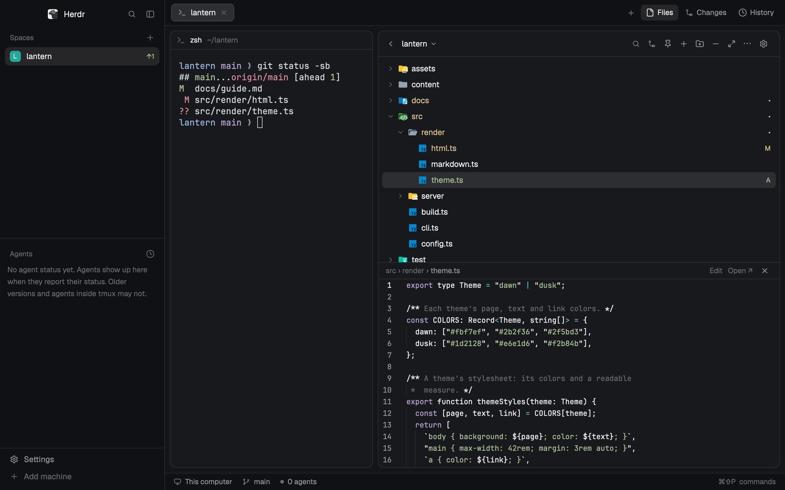

# Files Enhanced

A file browser for Herdr's side panel that follows the terminal you're working in: its folder as a
tree with git marks and file icons, a preview under it that edits and saves, fuzzy search by file
name and search and replace in file contents, a right-click menu (new file or folder, rename, move,
duplicate, compress, Trash, Open with your editor or a terminal program), several rows selected at
once and a cut, copy and paste clipboard for files. In a space on another machine it works the same.



This file is the brief: enough to build Files Enhanced from an empty folder. The files next to it
are one build of it. If they don't work on your Herdr, or you want it different, build it again from
here.

## What you see

One column of 13px text in a card like Herdr's Files card (the theme's surface, a 1px border, radius
10), unless the layout frames the block or it's a window. Only the theme's colors: a status, error
or code color under a 4.5:1 contrast where it's drawn takes the theme's text color (a mark's letter
still says what it is). Hints are dim on the page, muted on cards, raised buttons and a selected
row. Top to bottom:

- **The header**, 42px as on the Changes and History pages, a border line under it: ‹ (up a
  level); the folder's name in semibold with Herdr's muted chevron (on another machine a small badge
  with the machine's name, which a narrowing panel drops before ⤢); 24px icon buttons as those
  pages have, lit while on: Search, Changed files (Herdr's changes icon), Pin, New file, New folder,
  Collapse all, ⤢ Open Files in a tab (Herdr's pane zoom icon; in a layout block from 308px wide),
  ⋯ This folder's menu, and the gear (Settings, or Close settings while its window is open). A
  button whose menu is open stays lit. The name gives way before the buttons: the row fits a 300px
  panel.
- **The tree**: Herdr's Files rows at 26px, 16px more per level: a dim chevron, a 16px file type
  icon (with icons off, Herdr's file and folder glyphs, folders in the accent), the name
  (`src/main/java` for a compacted chain), on a nested repository's folder its branch or "Not read"
  with a small Read it button, a spinner while a folder loads, a 6px accent dot on a changed file
  modified in the last 10 minutes, and the git mark: M in the theme's yellow, A green, D and U red,
  • on a folder in its most urgent change's color. Names take their mark's color; git-ignored
  entries may be muted; selected rows are on the selected background, cut ones at half opacity. With
  no rows, Herdr's Files words ("Loading files…", "No files"), or "Nothing to show: the Files
  settings hide everything here".
- **The Changed view**, in the tree's place: the changed files newest first, each its mark, its name
  in the mark's color, its folder dim and its age (now, 3m, 2h, 5d; the accent while fresh).
- **The search**, in the tree's place: a 32px field with an accent border; Names and Contents and,
  for Contents, the toggles Aa, W, .* and ⇄ (Replace); 24px results, a name with its matched
  letters in semibold accent, or each file with its match count and its lines (number, text, the
  matches on the selection background, ↗ on the selected one); a foot line ("12 matches in 3
  files", why it stopped short). Replace adds a field, a check box per line and file, "Replace 12 in
  3 files" and a confirm with a red Replace.
- **The preview**, once a file is picked, the lower half: a 28px bar (the path as breadcrumbs, ●
  in the accent for unsaved edits, Rendered and Source for Markdown, Save, Edit or Done, Read-only
  with why in its tooltip, Open ↗, ✕); while editing a line under it ("Click the text to start
  typing"; in red "Changed on disk" with Reload and Overwrite, or "Unsaved changes — press again
  to discard"); then Herdr's editor at 12px in the terminal font in the theme's ANSI colors,
  Markdown rendered, or the image fitted.

**In a tab of its own** (⤢; named Files) the header has ⤡ (Herdr's unzoom icon) for ⤢, no pin
and no menu on the name; the tree is at the left (320px, dragged between 200 and 900px, the preview
keeping 280px), then a 7px line to drag (the accent while dragged) and the preview ("Pick a file to
see it here"). **In a window** (420px wide, 80% of the window's height) a slim bar with "Files" and
✕ tops the tree, which has no card and no ⤢.

**The menu**, Herdr's menu 250px wide: a muted glyph per meaning (an x only closes), hints at the
right (Double-click, ⌘X, F2, ⌘⌫), lines between groups. A file: Open (on Windows also Open
with…) · the Open with apps │ Reveal in Finder · Open terminal here · the terminal programs
· Ask agent about this… │ with Git Enhanced installed, in a repository, Show changes (a file
with a mark) · File history │ New file… · New folder… │ Cut · Copy · Paste · Duplicate
· Move to… │ Copy path · Copy relative path · Copy name │ Compress… · Rename… ·
Delete. A folder: Open in Finder · the apps · Open terminal here · the terminal programs · Ask
agent about this… │ Folder history │ then as a file's. The shown folder's (the background,
⋯): no row items, ending │ Settings…. Several rows: Cut · Copy · Copy paths │ Compress…
· Move to… · Ask agent about these… │ Delete 3 items…. On another machine there's no Open
or Reveal, and "Delete permanently" where it has no Trash.

**The dialogs** are Herdr's prompt and confirm, 440 wide: a title with Esc, a muted line ("In src ·
a name with / makes its folders too", "Move to the Trash: a.txt?", "Permanently delete: a.txt?"),
the field, a red error line, Cancel and the action (Delete in the theme's red), faded while it runs.
**The send dialog** (560×340) names the agent it goes to (a dot in its status color, its program
and tab; a list for several; "No agent here: Send starts pi"), with a note box, the paths, Cancel
and Send ("Start pi", "Send anyway"). **Move to…** (320×380): the shown folder's folders as a
tree ("here now" by the items' own, faded where they can't go), Cancel and "Move to src". **The
roots popup** (300px): "Follow terminal (app)" ("Terminal's folder" with following off) and up to 8
recent folders, a check on the current one.

**Shared with Git Enhanced**, drawn the same by both: **the tab header** (a stack's 34px header),
its pages as tabs like the Files and Changes buttons of Herdr's tab bar (26px, a 14px icon, a 12px
muted title, the shown one on the selected background), no gear; and **the settings window**,
640×560 like Herdr's own Settings: "Files settings" and ✕ over the tabs Files, Open with and
Agents, a foot with Reset this section, Reset all and "Saved as you change it". Files has a row per
Files setting; Open with what a double-click, Open ↗ and Open at a line use, and the programs
(ticked, found or not, in order, Add your own…); Agents the agent to start. With both mods
installed, Open with and Agents begin "Files Enhanced and Git Enhanced both use these."

## How it behaves

- **Where.** The focused pane's live folder, else the focused block's, else the active space's, on
  its machine (Herdr's Files way). A folder pinned for the space wins: the pin button, ‹ (it pins
  the folder above) and the roots popup pin; Follow terminal unpins. With following off, a space's
  first folder stays. Each place keeps its open folders, preview and selection. A pinned folder
  that's gone unpins itself and says so. While a file is edited the tree stays put.
- **Keeping up.** Here a burst of changes shows a quarter second after it starts, and all is read
  again every 10 seconds. On another machine the folder, its open folders and the previewed file are
  looked at every 4 seconds while the page is on screen, all of it every 10; nothing while hidden or
  behind another page, a refresh when it shows. Marks come from the folder's repository and those
  inside it, one folder down by default (else the Changed view says "Not a git repository", "git
  isn't installed" or "No changes"). One inside whose own git config has more than what git writes
  and plain preferences isn't read until you press Read it (its tooltip names those settings), which
  trusts that config until it changes.
- **Clicks and keys.** A folder opens or closes; a file is previewed; a double-click or Open ↗
  opens it (Open with's choice, else the system's way); ⌘-click adds a row, Shift-click a range. A
  right press opens the row's menu (the selected rows' when it's one of them), the shown folder's on
  the background. A breadcrumb folder shows it in the tree; the name opens the roots popup; files
  dropped from Finder on a folder or the tree are copied in. Keys: ↑ ↓ (J K) move and preview,
  → (L) and Enter open a folder, ← (H) closes it or goes to the parent, Shift+Enter opens in its
  program, F2 renames, Del or ⌘⌫ deletes, ⌘X ⌘C ⌘V cut, copy and paste files (Ctrl off
  macOS), / and ⌘⇧F search, Esc goes back to one selected row, then closes the preview; while a
  file is edited j, k, h and l do nothing there. Menus and dialogs take ↑ ↓, Enter and Esc.
- **Changing files.** Rename picks the name without its extension; New file and New folder take a /
  (`x/y.txt` makes `x`); nothing is made or put over what's there; a rename that only changes case
  works. A taken name pasted gets a number (`a 2.txt`), pasted where it came from or duplicated a
  copy name (`a copy.txt`); a folder can't go into itself; a pasted cut empties the clipboard, which
  every copy of the mod shares. Move to… moves into the folder picked (a double-click or Enter).
  Compress makes `a.txt.zip` or `Archive.zip`. Delete goes one by one, the ones that fail staying
  listed with why: here always to the Trash (Finder's, so Put Back works; without Automation
  permission macOS's own trash command, else it says how to allow it; the Recycle Bin on Windows),
  on another machine to its Trash where it has one, else for good. Then every tree reloads and
  selects the new item; Paste and Duplicate keep the menu open until done.
- **Search.** Names ranks paths by a fuzzy match (the best 100); Contents lists the files by path
  (2000 matches at most), ignoring case for a query without capitals unless Aa is on. Both start 200
  or 300ms after the last key, stop after 5 seconds, leave out what the Files settings hide, and
  follow .gitignore with fd and rg (without them `node_modules` and `.git` are left out). A pick
  previews the file and opens its folders in the tree; on Contents a double-click or ↗ opens it at
  that line, and a file row folds. Replace writes each checked file only if it still holds what the
  search read (one changed since is skipped and said), then searches again. Esc closes it.
- **Editing.** Edit makes the text writable, but the keyboard stays on the tree until you click the
  text. ⌘S or Save writes only if the file still holds what was loaded, else "Changed on disk":
  Reload (your edits go) or Overwrite. With unsaved edits the first Esc, ✕, Done or other file
  only warns. Read-only past 400,000 characters, and on another machine past what a save can carry
  or without base64 or openssl. Rendered and Source switch until the next file.
- **On another machine** everything runs there, and what's offered follows what it has; until that's
  known nothing is said missing. A save goes up to 1 MB (about 720 KB on a Mac). Open with's
  terminal programs run in a terminal of that space; Zed, VS Code and Cursor (these two only without
  a port in the ssh target), and a program of yours given a command for it, open the file over ssh
  from here; other apps aren't offered. Files dropped from this computer aren't copied there.
- **With Git Enhanced installed** (looked for at the start and every 10 seconds), Show changes, File
  history and Folder history make it show that diff, or its History searching that path, and bring
  its page forward (in Herdr's own layout, History under the Changes block's switch). A reveal
  request (its Show in Files, or any mod's) goes to a tree whose folder holds the path, a Files tab
  of the active space first: the folders open down to it, it's selected and its page comes forward.
  If none holds it, the panel's tree that follows the terminal pins the folder its own and the path
  share, and shows it there. Requests older than 15 seconds are let go.
- **Ask agent about this…** Send pastes the note and the paths into the agent picked (the focused
  one, else an idle one) and brings it up; a busy one takes a second press. With no agent in the
  space it starts the Agents setting's (pi) in a new tab with the text as its first message, or
  right of the focused pane with it as the last argument.
- **Tabs and windows.** ⤢ opens the shown folder in a tab (one per folder in a space) and hides
  the panel; ⤡, or closing the tab another way, shows the panel again on Files. ‹ moves the
  tab's own folder up; the line stays where it was dragged. ⌘⌥F opens the window and closes it;
  its bar drags it. A tab of the header shows its page.
- **The settings window** opens at Files from the gear or Settings…; the gear closes it when it's
  open. One window whichever mod opens it: the other mod's takes its place. Changes are kept at once
  (a text field 450ms after the last key, on leaving it, on closing). Reset this section and Reset
  all take a second press within 3 seconds, a red line meanwhile saying Reset all resets Files, Open
  with and Agents (with both mods installed, that Git Enhanced uses the last two). Open with and
  Agents look for their programs when first shown and on Check again. Esc closes a drop-down, a
  field, the form, then the window; the title bar drags it.

## Built from

- **One mod**, `mods/files-enhanced/`; a layout block points at it, and `mod.open` opens it as a
  window. Its `mod.json`:

  ```json
  { "place": "none", "focusable": true, "title": "Files Enhanced",
    "overlay": { "kind": "window", "width": 420, "height": 0.8 } }
  ```

  `main.js` exports one view whose part `props()` picks: no role, the tree (with `{ root, on }` a
  tab's, with only `{ overlay }` the window's); `role` `menu`, `dialog` (`action` newfile,
  newfolder, rename, compress or delete), `roots` and `moveto`, copies opened with `openOverlay`
  that do their work themselves; the shared `tabs`, `settings` and `send`. `props.frame: "none"`
  leaves the card out.
- **Its own files** are based on Herdr's shipped Files mod (`main.js`, `tree.js`, `place.js`,
  `preview.js`, the listing in `machine.js`), menu mod (`menu.js`) and prompt and confirm mods
  (`dialog.js`), Apache-2.0; adapted from VS Code (MIT) are the copy names, the paste rule, the
  repository scan, file nesting and rg's arguments. `machine.js` makes every file operation, here or
  there; `id.js` writes the folder's name once (`ID`, `PART` "files").
- **Shared with Git Enhanced**: unchanged copies of the repository's `shared/`, importing only each
  other and `./id.js`: the tab header (`paneltabs.js`, role "tabs", props `stack`, default
  "panel-body", and `icons`), the settings window (`settingsview.js`, role "settings"), the send
  dialog (`send.js`, role "send"), the settings' keys and defaults (`panelsettings.js`), Open with
  (`openwith.js`; `shellwords.js` adapted from shell-words, MIT), reveal requests (`reveal.js`),
  pages in tabs (`tabs.js`), menus at their buttons (`menuat.js`), repository trust (`gittrust.js`,
  `repotrust.js`), readable colors (`ink.js`), weakly held copies (`weakcopies.js`).
- **Herdr**: `spaces`, `panes`, `focused`, `agents`, `layout`, `exec`, `hc` (`send`,
  `machine ls --json`), `readTextFile`, `writeTextFile`, `watchFolder`, `theme`, `settings`,
  `window`, `appHome`, `home`, `props`, `shared`, `setShared`, `openOverlay`, `closeOverlay`,
  `notify`, `nextCommand`; `run` with `terminal.open`, `tab.new`, `tab.select`, `tab.close`,
  `layout.select`, `layout.show`, `layout.hide`, `agent.focus`; `gpui-kit`, `gpui-base`,
  `fs/promises`, `crypto`, `buffer`.
- **Programs**, through `exec`, here or on the space's machine: POSIX `sh` scripts (GNU or BSD
  `stat`, no perl) that list (the folder and its open folders in one call), make, rename, copy and
  move (never over a name), zip, delete and save (a temp file beside the file, put over it only if
  the file's `cksum` still matches; exit 3 when not); `git rev-parse --show-toplevel` and
  `git status --porcelain=v1 -z --no-renames --untracked-files=all --branch` (`--ignored=matching`
  when ignored entries dim or hide), with `-c core.fsmonitor=false -c core.hooksPath=/dev/null`, and
  `git config --file … --list` for the trust check; `find` for repositories (every 30 s at most);
  `fd` (else `find`), `rg --json` (else `grep`), `zip` (`ditto` for one item on a Mac), `gio`,
  `trash-put`, `trash`, `base64` or `openssl`, after one probe per machine (`uname -s`,
  `getconf ARG_MAX`, `command -v`). Here only: `osascript` (Finder's delete), `/usr/bin/trash`,
  `open` or `xdg-open`, and Open with's commands (in the background, two seconds to fail); on
  Windows `powershell`, `rundll32` and the file manager.
- **Reads and writes**: `files-enhanced.settings` (`hidden`, `exclude`, `ignored`, `sort`,
  `foldersFirst`, `follow`, `freshMinutes`, `markdown`, `wrap`, `icons`, `compact`, `nesting`,
  `nest`, `repoDepth`), `herdr-enhanced.open-with`, `herdr-enhanced.agents`,
  `herdr-enhanced.trusted` (`"<machine>:<folder>"` → its config's fingerprint); its own keys
  `.pins`, `.recent`, `.clipboard`, `.changed` (`{ t, on, select, files }`: every tree reloads),
  `.refollow`, `.tabSplit`, `.tabs`, `.titles` (a Files tab's name, for a pane header that reads
  `<mod>.titles`) and `.reveal` (`{ at, full, on }`, read); `git-enhanced.reveal`
  (`{ at, root, on, path, page }`, written); whether `<appHome>/mods/git-enhanced/main.js` exists.
  Images are copied into `cache/files-enhanced/` (the newest 20 kept).
- **Art**: `icons/` (254 Material Icon Theme icons, MIT, its LICENSE there, light variants; made by
  the repository's `tools/make-icons.mjs`), `glyphs/` (Herdr's interface icons; Lucide's
  message-square, scissors, copy, clipboard-paste, copy-plus and trash), Herdr's four Files icons,
  and Herdr's own by path: `mods/changes/changes.svg`, `mods/files/file.svg`, `mods/pane/zoom.svg`
  and `unzoom.svg`, and `mods/workspace-chrome/`'s `clock`, `x`, `chevron-down`, `check`, `spinner`.
- **`keys.json`**: `{ "global": { "cmd-alt-f": "mod.open:files-enhanced" } }`. Commands:
  `files-enhanced.focus` (also `pane.go`'s), `.search`, `.contents`, `.refresh`, `.collapse`; in the
  send dialog `.send`, `.close`.
- **In a layout.** In Herdr's own layout and its clones only the `files` block of the `panel`
  column's `panel-body` stack changes, its id kept for the tab bar's Files button, nothing added:
  `{ "id": "files", "type": "block", "content": { "mod": "files-enhanced" } }`. A stack with no
  other way between its pages, or whose own row of tabs (a `content: "tabs"` header) it replaces,
  takes our header, each page with a `title`:

  ```json
  "header": {
    "content": { "mod": "files-enhanced", "props": { "role": "tabs", "stack": "panel-body" } },
    "height": 34
  }
  ```

  A Files block that shows another mod: change its `content.mod` only. Elsewhere any block. Herdr's
  shipped layouts are read-only (edited in place, one moves to `<name>-edited`): clone first,
  `herdr-app do layout.clone '{"name":"main","as":"my-main"}'`. The herdr-enhanced entry is Herdr's
  own layout ready made. herdr-t3 as published has no Files panel; in one given a panel (a
  `panel-body` stack), its Files block gets `"mod": "files-enhanced"`, its id and title kept, the
  stack's header can be ours, and its own panel toggle keeps showing the panel.

## Watch out

- Herdr reloads a mod in place when its files change: each copy gets a new object without the old
  one's `close()`, and the old modules stay in the memory all mods share (256 MiB; about 1.3 MiB per
  reload of this mod). Hold module-level sets of copies weakly, or every replaced copy stays until
  Herdr restarts.
- Herdr refuses `cx.notify()` and `setShared()` while a view renders, and `render()` reaches the
  refresh, the announcements, the reveal requests and the Open with detection: each task they start
  awaits first.
- A tooltip is built from the frame its hover began in: a toggle's id names its state (`fm-pin-on`,
  `fm-pin-off`), or it keeps its old words after a click.
- A popup opens where the press was: a button's menu keeps the button's bounds from `on_mouse_down`
  and opens 3px under it, given as `at` (Herdr zooms a popup's size, not its `at`). Herdr closes a
  popup at a press beside it, so the click after a second press must not reopen it; the button stays
  lit until the menu's copy says, in its `close()`, that it went. A popup is as tall as its content
  (Move to's list has its own height), and closing it cancels its tasks (items that copy files keep
  the menu open until done).
- Herdr says nothing when a tab closes: the panel's tree, alive while hidden, looks every 1.5 s for
  its Files tabs closed by ×, ⌘W or the tab bar, and shows the panel again.
- `image()` reads only the app's folder (16 MiB at most), and `writeTextFile` and `watchFolder`
  don't reach another machine, where `exec` has no stdin: images are copied into the cache (from
  there as base64, 5 MiB at most: `exec` keeps 8 MiB of output), a save there rides in arguments
  (98,304 base64 characters each, under Linux's 128 KiB; at most three quarters of its `ARG_MAX`
  less 64 KiB, and 1 MiB), and its folder is polled. Here `watchFolder` can fail (on Linux past 4096
  folders): the 10-second refresh covers it.
- `fs.readdir` can't tell a link to a folder from a file: folders are listed with `sh` here too.
  Windows has no `sh`: PowerShell lists, makes, renames, deletes and copies dropped files, and the
  clipboard, search and compress are left out (untested).
- Replace finds the matches again with a JavaScript RegExp in the text it read: a regular expression
  JavaScript can't read blocks it, and a match it reads differently from rg is left as it was (the
  result line says so).
- Herdr's editor can't take the keyboard by itself (`EditorState` has no `focus()`): hence the hint,
  and j, k, h and l ignored in the tree while editing.
- An entry named `.git` isn't always a repository (GitKraken leaves a `.git` folder with only `gk/`
  in it): the scan keeps a `.git` folder with a `HEAD` file and a `.git` file whose first line
  starts with `gitdir: `, checked by the same `find` (`-exec sh -c KEEP sh {} +`).
- The folder's name is written once, in `id.js`: a copy renamed by hand changes that line (Herdr's
  `mod.clone` does it). Git Enhanced finds this mod as `files-enhanced`; the settings keys keep
  their names. The shared modules are the same files in both mods: change them in the repository's
  `shared/` (`tools/copy-shared.mjs`), never in one mod.
- The settings window is a `kind: "window"` overlay: a press its controls don't stop drags it, so
  each stops its own; it focuses its own handle (again 300 ms later); its view's `close()`, ✕ and
  Esc save the text that waits.
- Limits: 1000 entries per folder, 5,000 rows; compact chains 10 deep; 20 repositories below; 500
  changed files; fd stops at 400 names, `find` at 20,000; 6 MiB of rg's output; 40 open folders
  polled.
- Tests must not open apps: their stubs answer `open`, `osascript`, `zed`, `code`… and the Open
  with launcher.

## Done when

- `herdr-app check mods/files-enhanced` passes.
- In Herdr's own layout (cloned), and under our tab header, the Files page shows the focused
  terminal's folder, follows a `cd`, and keeps open folders when you come back.
- In a git repository modified files turn yellow, new ones green, their folders get a dot; the
  Changed view lists them newest first.
- Rename… on `a.txt` picks `a`; `b` and Enter renames it and selects `b.txt`. New file `x/y.txt`
  in an empty folder makes both and selects `y.txt`. Delete puts the file in the Trash. `a.txt` →
  `A.txt` works on a Mac's disk.
- ⌘C on a file, ⌘V on a folder that has one of that name: the copy is `a 2.txt`, selected.
- Ask agent about this… on a file, with no other panel mod installed: the dialog names the space's
  agent (or says it starts pi); Send puts the note and the path in its terminal.
- With Git Enhanced installed, Show changes opens a changed file's diff, File history the History
  page searching `path:` that file (in Herdr's own layout the Changes block's History, no new tab);
  without it neither is there. Its Show in Files opens the folders down to that file here and
  selects it.
- Edit, change, ⌘S: saved; change the file outside, save again: Changed on disk.
- On another machine the tree lists its folder, a new file there shows within seconds, a save goes
  through (and refuses over a file changed there), and Delete says whether it goes to a Trash.
- Under our tab header the stack's pages show as tabs and a click switches. The tree's one gear (in
  a window too, whose bar has none) and Settings… open one "Files settings" window (Files, Open
  with, Agents) at Files; opened from either mod it shows that mod's window in its place, and a
  change shows at once. The gear pressed again closes it ("Close settings"); after ✕ or Esc the
  next press opens it.
