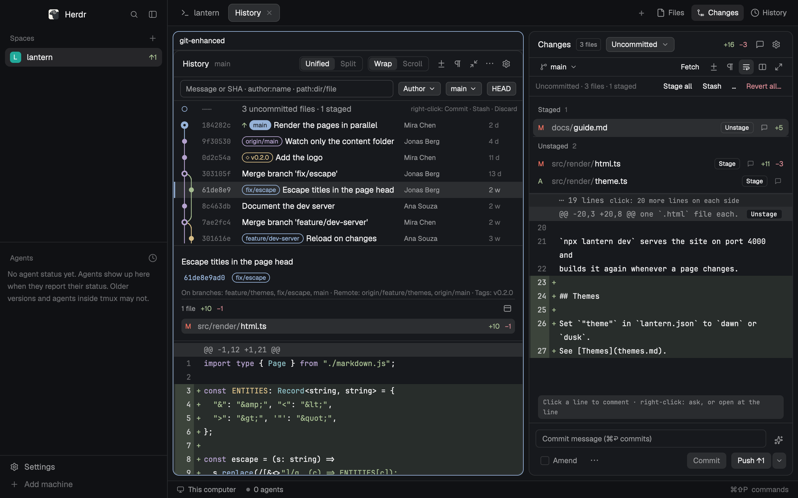

# Git Enhanced

A git panel for [Herdr](https://herdr.dev), built on the Changes panel that ships with it: the
Changes, History and Review pages for the repository of the terminal you're in, on this computer or
in a space on another machine (an SSH machine added with `hc machine add`). Stage files, hunks and
lines, commit and amend, push and pull, switch branches, stash and undo, send comments on diff lines
to the space's agent, read the commit graph with menus down to an interactive rebase, and see, or
take back, what each agent turn changed.



## What it does

### The Changes page

- Staged and Unstaged sections (a file staged, then edited again, is in both), new files, renames as
  `old → new`, conflicts. Stage, Unstage and Revert… per file; Stage all, Unstage all, Revert
  all…. A repository inside this one shows as `sub/` with "repository": a click says its changes
  are in that repository and Show its changes switches to it; Stage all and Commit leave it out (and
  say so); only its right-click menu stages it as an embedded repository, after asking. Every revert
  asks first and keeps a copy: ⋯ → Recently discarded… brings it back.
- The open file's diff: wrapped (the default) or scrolled sideways with the line numbers and buttons
  staying put; whitespace ignored or not (¶, a switch, lit while ignored: hunks can't be staged
  then) and the lines of context (±: 3, 10 or the whole file), from the settings or the bar;
  `⋯ N lines` rows between hunks show more context; images before and after with their sizes. One
  column, or old | new side by side (Split, beside Wrap; the choice is kept and shared with
  History).
- Each `@@` row has Stage and Revert… (unstaged) or Unstage (staged): one hunk through
  `git apply`. Single lines too: click the rows (another click widens them) and the comment box
  offers Stage lines, Unstage lines or Discard… (a copy is kept).
- Commit (only what is staged; with nothing staged it asks, then stages everything), Amend (a commit
  already pushed asks once more); ⌘↩ commits once per press. The pen by the message box has an
  AI agent write the message (it only fills the box): pi, Claude Code, Codex, OpenCode or a command
  of your own, picked in the settings (Git → Committing → Commit messages written by) or with
  the pen's right-click; both change the same setting.
- Push ↑N, or Publish a branch without an upstream, and ▾ beside it: Sync (pull with a rebase,
  then push), Force push (with lease) (git refuses when the remote moved, or holds commits fetched
  but never in your branch), Push every tag. Fetch; Pull ↓N ▾: fast-forward only, rebasing or
  with a merge, uncommitted changes stashed around it.
- The branch picker: switch, New branch…, Back to the previous branch, Clean up branches…
  (merged, or their upstream gone), ↑ ↓ or "gone" by each branch, remote branches; a branch's
  right-click: rename, delete, merge, rebase, Fast-forward to its upstream, Merge into ▸
  (fast-forward only, a merge commit, squash, without committing), Rebase onto it ▸ (autosquash,
  autostash, stacked branches moved along). A branch checked out in another worktree says where, and
  a click goes to that worktree's space; its right-click fast-forwards it there and deletes it after
  removing or detaching that worktree (you choose, and are asked once).
- Conflicts: a merge, rebase, cherry-pick, revert or `git am` that stops shows a bar with Continue,
  Skip…, Abort… and Ask an agent…; a conflicted file's menu takes a side, deletes it, starts
  it over or marks it resolved, and its diff becomes a conflict view where each block is resolved by
  a click (ours, theirs, both, the base) and saved.
- Stashes: the list, a stash's changes in place of the diff, Apply, Pop, Drop…, and its ⋯: Apply
  (staged as it was), Branch from it…, Rename…, Compare with working tree; Drop all N… (Drop
  it… with one); Stash… with choices (everything, staged only, some files; keep the staged
  changes; ignored files too).
- ⋯ by Commit: Undo last commit, Undo last git action… (from HEAD's reflog), Move my unpushed
  commits to a new branch…, Copy changes as patch ▸, Apply a patch… (email patches become
  commits), Recently discarded…, Settings….
- Scopes: the uncommitted changes, the last commit, the branch against its base, one commit, the
  working tree against any branch, tag or commit, or what an agent's turn changed.
- Several repositories under one folder: the most recently changed shows; a switcher picks another
  (remembered per folder).
- Right-click a file row: Revert changes… or Delete file… (a new file), and Show in Files with
  Files Enhanced installed (a repository inside this one: Stage it as an embedded repository…,
  which asks first).
- Right-click a diff line: Ask about it, Open at line N in the editor from the settings (here, or
  over SSH for a space on another machine), or Blame line N (who, when, the commit, blame before
  that change).

### Comments and the agent

Click a diff line (or a range, a hunk, or a file's bubble) to write a comment; comments wait as
drafts per repository and scope. Submit review sends them as one message to the space's agent
(`hc send`), through a dialog that says who gets it; with no agent in the space it starts the one
from the settings. Ask about diff does the same for the open file's diff.

### The Review tab

⤢ by the diff opens the page full width in a tab of its own on that repository: Unified | Split,
changed words marked, a Viewed box per file (kept until the file's diff changes), keys j/k (hunk),
n/p (file), s/u/r (stage, unstage, revert the hunk), v (viewed). Opening it again shows the tab
already open; the panel hides while it is open.

### The History page

- The commits with their lanes, ↑ not pushed, ↓ not pulled, labels; a search (words, a hash,
  `author:"name"`, `path:dir/file`, `branch:name`), Author ▾ to fill it, the branch menu (the
  current branch and its upstream, All branches, or one branch; its button says which), HEAD, Load
  more. A large repository without git's commit-graph (every page then reads the whole history) gets
  a line offering to write it (`git commit-graph write --reachable`).
- Between the subject, the author and the date, a line shows when the pointer is over it: drag it to
  resize those columns (a wider date column shows the date and time), double-click it for the
  default widths. The panel and the tab keep widths of their own.
- A click: the commit's message (its body under Show full message), people, parents, labels and
  files (a file's right-click: Show in Files, with Files Enhanced installed), with the clicked
  file's diff; the line between the list and the commit drags, and so does the one above the diff.
- Uncommitted changes are a row at the top: their files and diffs, Commit…, Stash…, Discard
  all….
- A commit's right-click menu, in git's words: its labels (each with its own menu: a branch's check
  out, merge, rebase onto, push, set upstream, rename, delete; a remote branch's check out, fetch,
  delete there, asked twice; a tag's push and delete; a branch checked out in another worktree goes
  to that worktree instead of being checked out); Create branch here…, Create tag here…, Create
  worktree here… (the worktree opens as a space, the agent started there if you want); Checkout
  commit…, Cherry-pick onto main…, Revert…; **Reset main to here ›** (Soft · keep changes
  staged…, Mixed · keep changes unstaged…, Hard · discard changes…) and **Interactive rebase
  ›** (Reword…, Squash into parent…, Drop…, Interactive rebase from here…); Show in
  Changes, Compare with working tree, Compare with the selected commit; Open on GitHub (or GitLab,
  Bitbucket…), Copy SHA, Copy ›. Its title is the commit's subject, on two lines at most.
- ⌘-click and ⇧-click select several commits: cherry-pick them (oldest first), revert them
  (newest first), copy them as email patches. A commit's Create tag here… makes an annotated or
  lightweight tag, or moves one there; Copy › has its message, its patch and its email patch; its
  details say which branches and tags hold it; a file of it opens as that commit has it (Open this
  version).
- ⋯ in History's header: Worktrees… (open one as a space, lock, move, remove (it names the
  ignored files, such as .env, that go with the folder, and the space in it, which closes first),
  forget the missing, clean up the merged: you tick which; one with ignored files stays), Remotes…
  (add, rename, URLs, where pushes go, remove), Reflog… (restore an entry as a branch, by moving
  the branch, or detached), Fetch every remote, Bisect (the selected commit is bad; a bar marks each
  tested commit Good, Bad or Skip until git names the first bad one), prune a remote's tags.
- Rewriting asks first, and a commit that is already on a remote branch is only rewritten once you
  tick that you know its history then differs from the remote's. The interactive rebase has an
  editor: the commits oldest first, an action each (pick, reword, squash, fixup, drop; keys p r s f
  d), ↑ ↓ to reorder (Alt+↑/↓), and a message box wherever git will ask for a message.
- The commit beside the list or under it: the layout button at the right end of the commit's files
  row ("1 file +1 −0") picks Automatic (side by side from 760 px wide), Side by side or Stacked,
  for the panel and the tabs alike; both lines (the list's and the one between the commit's
  information and its diff) drag.
- ⤢ opens the history in a tab (the panel hides, also where History is the Changes block's own
  page); ⤡ in the tab brings the panel back, and so does closing the tab another way (the pane
  header's ×, ⌘W).

### Agent turns

While an agent works in a repository, the panel's Changes page keeps a snapshot of the working tree
at the turn's start and end (git objects under `refs/git-enhanced/`, never touching your index). The
scope picker's "An agent's turn…" shows what a turn changed; Revert this turn… puts the files
back as they were before it, and Undo takes that back.

### Another machine

Every git command and script runs there through Herdr's `exec`, patches and images travel as base64,
and the repository is polled instead of watched (the Changes page every 4 s, the History page every
10 s). A machine without base64 or openssl gets no hunk buttons (whole files still stage). Agents
that write commit messages always run on this computer.

### With Files Enhanced

Git Enhanced works alone. With [Files Enhanced](../files-enhanced/README.md) installed too, a file
row and a commit's file have Show in Files, and Files Enhanced's Show changes, File history and
Folder history open this mod's pages on that file or folder; neither mod calls the other, they ask
through the reveal keys (below, "For other mods"). Both share the settings window's Open with and
Agents.

## Install

The short way: tell your agent "Read ~/.config/herdr-app/AGENTS.md, then add this mod:
https://github.com/chaofanma/herdr-enhanced/tree/master/git-enhanced". Its page in Herdr's gallery:
herdr.dev/mods/chaofanma/herdr-enhanced--git-enhanced. Or by hand: copy the mod into Herdr's mods
folder, check it, and point a block of the layout you use now at it. Before copying, know that it
runs programs (git, sh, find and the rest under "What it runs and touches") and that its pen sends a
diff to the agent you pick.

```sh
git clone https://github.com/chaofanma/herdr-enhanced.git
cp -R herdr-enhanced/git-enhanced/mods/git-enhanced ~/.config/herdr-app/mods/
herdr-app check ~/.config/herdr-app/mods/git-enhanced
```

A name that's taken already (a mod of yours called `git-enhanced`): rename the new folder and the
`mods/git-enhanced/` path in its `id.js` (Herdr's `mod.clone` does both), and use that name below;
Files Enhanced looks for `git-enhanced` by that name, so its links to a renamed copy stop. To
update, copy the new folder over the old one: Herdr reloads a mod whose files changed.

For Herdr's own layout with this mod and Files Enhanced in its panel, ready made, see [the
herdr-enhanced layout](../herdr-enhanced/README.md) (its page in Herdr's gallery:
herdr.dev/layouts/chaofanma/herdr-enhanced--herdr-enhanced).

### In the layout you use now

Its `mod.json` says `"place": "none"`: Herdr doesn't dock it by itself; a layout block points at it.
Open your layout, `~/.config/herdr-app/layouts/<name>.json` (the one shown is `shared("layout")`).

In Herdr's own layout (`main`) and its clones, the tab bar already has Files and Changes buttons:
they show the `panel` column and select its `panel-body` stack's `files` or `changes` block. Point
the `changes` block at Git Enhanced, replacing only its `content`, and add nothing else:

```json
{ "id": "changes", "type": "block",
  "content": { "mod": "git-enhanced", "props": { "palette": "theme" } } }
```

Keep the id `changes`: the tab bar opens the panel's page by it. History is in the Changes block:
its page's name is a Changes | History switch, History drawn in the same block, and Files Enhanced's
File history and Folder history open it there. No header and no `history` block here: the tab bar is
the panel's row of tabs, and a header of ours would be a second one.

Our tab header (the stack's pages as tabs, like Herdr's own Files and Changes buttons; either mod
draws it) and a `history` block are for a panel whose stack has no other way between its pages, or
one whose own row of tabs the header replaces (herdr-t3's `content: "tabs"` header, for one). There
give each page a `title` (its tab shows it, else the id); under the header the Changes block has no
switch, and the `history` block is History:

```json
{ "id": "history", "title": "History", "type": "block",
  "content": { "mod": "git-enhanced", "props": { "palette": "theme", "view": "history" } } }
```

```json
"header": { "content": { "mod": "git-enhanced",
                         "props": { "role": "tabs", "stack": "panel-body" } }, "height": 34 }
```

A layout without a panel takes it in any block: `"content": { "mod": "git-enhanced" }` (with
`"props": { "view": "history" }` for History; a Changes block outside a stack with our header has
the switch too).

Herdr's shipped layouts (`main`, `terminals`, `win98`) are read-only: one edited in place is moved
to `<name>-edited` on the next start and Herdr's own put back. Only for those, clone it first and
edit the clone (`layout.clone` switches to it):

```sh
herdr-app do layout.clone '{"name":"main","as":"my-main"}'
```

### A window of its own

`mod.open` opens Git Enhanced as a window over the layout, 760 px wide and most of the window's
height, and the same again closes it. This entry's `keys.json` binds it to ⌘⌥G; merge its line
into yours (`~/.config/herdr-app/keys.json`, asking first if the key is taken):

```json
{ "global": { "cmd-alt-g": "mod.open:git-enhanced" } }
```

The window has a slim bar with Changes | History and ✕ (the page's own gear opens the settings
window). Drag it by the bar; it stays where you drop it. A window's Changes page doesn't fetch or
record agent turns by itself: the panel's copy does.

## Keys

| Key | Where | What |
| --- | --- | --- |
| ⌘⌥G | anywhere (this entry's `keys.json`) | the window |
| ⌘↩ | the Changes page | Commit, once per press; in the comment box, add the comment |
| Enter, Shift+Enter | the comment box | add the comment; a new line |
| Esc | the Changes page | leave the message box, or close the comment box |
| j / k, n / p | the Review tab | next / previous hunk, file |
| s / u / r, v | the Review tab | stage, unstage, revert the hunk; Viewed |
| j / k or ↓ / ↑ | History | move the selection |
| p r s f d, Alt+↑ / ↓ | the rebase editor | pick, reword, squash, fixup, drop; move the row |

Optional commands for `keys.json`: `git-enhanced.submit` (send the review), `.ask` (ask about the
open diff), `.clear` (drop the drafts), `.scope` (next scope); in the send dialog
`git-enhanced.send` and `git-enhanced.close`:

```json
{ "mod:git-enhanced": { "cmd-shift-enter": "git-enhanced.submit",
                        "cmd-shift-a": "git-enhanced.ask" } }
```

## Settings

The gear at the right end of the Changes page's top row, and of History's, opens the settings
window, "Git settings", wherever the page is (under the tab header, in Herdr's own layout, in a
window or in a tab); pressed while that window is open, it closes it (its tooltip says "Close
settings" then, else "Settings"). Settings… in ⋯ by Commit opens it too (it only opens). It
opens at Git; there is one settings window at a time, and opened from Files Enhanced's gear it is
replaced by Files' window. Every change is saved as you make it; Reset this section and Reset all
ask for a second press, and Reset all resets Git, Open with and Agents.

Open with and Agents are shared with Files Enhanced (see [its README](../files-enhanced/README.md)):
Git Enhanced uses Open with's program for lines (a diff line's Open at line N) and the agent from
Agents when a space has none to ask.

The Git page writes `git-enhanced.settings`, a shared key in Herdr's `shared.json` that you can also
write by hand; every field is optional:

| Field | Default | What |
| --- | --- | --- |
| `whitespace` | `false` | ignore whitespace in diffs (`git diff -w`) |
| `context` | `3` | lines of context: `3`, `10` or `"file"` |
| `codeSize` | `12` | the diffs' size, `11` to `14`; `"terminal"`: the terminals' size less one |
| `repoDepth` | `1` | folders down to look for more repositories (`0`: only the folder's own) |
| `autoFetch` | `0` | minutes between automatic fetches; `0` never |
| `askStageAll` | `true` | Commit with nothing staged asks before staging everything |
| `askAmendPushed` | `true` | amending a commit already pushed asks once more |
| `commitAgent` | `"pi"` | the pen's agent: `pi`, `claude`, `codex`, `opencode` or `custom` |
| `commitCommand` | `[]` | `custom`'s argv; `{prompt}`, `{model}` filled in (else the prompt last) |
| `commitModel` | `""` | the pen's model; empty: the block's `commit_model`, else the agent's own |
| `template` | `""` | what an empty commit message starts with, such as `"feat: "` |
| `turns` | `true` | record agent turns |
| `turnsKeep` | `50` | turns kept per repository |

The block's props: `palette` (`"theme"` colors code with the theme's colors; without it the fixed
`"one-dark-pro"` colors, or `"dark-plus"`; in a light theme, one whose text is darker than its
surface, the theme's colors always: the fixed palettes are made for a dark background),
`view: "history"`, `font_size` (the code's, over the settings' Code size), `commit_model` (the pen's
model when the settings have none), `base` (the branch scope's base branch).

**The pen sends your diff to the chosen agent's model provider.** It runs that agent's one-shot mode
on this computer (`pi -p`, `claude -p`, `codex exec`, `opencode run`, or your command) with the
staged diff (else every change), the new files and the last subjects, and puts the answer in the
box. The pen's right-click offers only agents installed here; the settings window lists all five,
each marked "found" or "not found here" (it looks for them with `command -v`). Your own command is
typed in the settings (split like a shell: quotes for words with spaces); `{prompt}` is replaced by
the prompt (else it goes last), `{model}` by Commit message model, which pi, Claude Code, Codex and
OpenCode get as `--model`. Empty (and no `commit_model` prop), each agent writes with its own
default model; pi always runs with thinking off.

### Themes

It draws in the theme Herdr shows, with its colors only, and reads in each of the six it ships
(graphite, ink, moss and atom-one-dark, dark; paper and win98, light): the tests draw every page,
menu and dialog in each and check that its text and its icons have enough contrast. Pages sit on the
theme's `surface`. A status or code color that doesn't read where it is drawn (win98's green on its
silver) is drawn in the theme's text color instead. In a light theme the diff's code takes the
theme's own colors, whatever `palette` says.

## For other mods

Git Enhanced shows a file or a folder when a shared key asks it to (Herdr's `setShared`; the asking
mod brings the page forward too, with `layout.select` and `layout.show`, so a page that never showed
starts and takes it). `at` is `Date.now()`: a request older than 15 seconds is let go.

```js
// A file's diff on the Changes page, or path:<path> in the History page's search.
setShared("git-enhanced.reveal",
  { at: Date.now(), root: "/home/me/app", on: null, path: "src/main.js", page: "changes" });
setShared("git-enhanced.reveal",
  { at: Date.now(), root: "/home/me/app", on: null, path: "src", page: "history" });
```

- `root`: the repository's folder; `on`: the space's machine (`spaces()[i].machine`, null here);
  `path`: relative to `root`, a file or a folder (`""`: the whole repository).
- The copy showing that repository takes it (the panel's Changes or History page, else a Review or
  History tab of it); else the panel's page switches to it when it's one the repository switcher
  lists; else it opens a Review or History tab on it. A layout with no History page but a Changes
  block with its Changes | History switch (Herdr's own layout): that block shows its History, chosen
  and filtered the same way, and comes forward. A read-only scope goes back to the uncommitted
  changes; a file without changes there says so under the diff.
- Show in Files asks Files Enhanced the same way, with `files-enhanced.reveal` (see [its
  README](../files-enhanced/README.md)). Each mod looks whether the other is installed as
  `fs.exists(appHome() + "/mods/<name>/main.js")` and offers its links only then (looked at again
  every 10 s, and when the settings window opens).

## Repositories it reads

A repository's own git config (`.git/config`) can make git run programs while it reads: an
fsmonitor, a filter, a diff driver, an ssh command. So Git Enhanced reads a repository it found by
looking below the shown folder only when every setting in its own config is one git writes itself or
a plain preference, or when you said so: the Changes page, History and the switcher show "Not read:
its git config has settings beyond the usual ones" (the tooltip names them) with **Read it**. Read
it keeps that config's fingerprint in `herdr-enhanced.trusted` (shared with Files Enhanced; delete a
key to be asked again); when the config changes, it asks again. The repository of the shown folder
(the focused terminal's, or the one you picked) is always read, and so is an agent's for its turn
snapshots: you work there. Only that one or a trusted one fetches by itself (`autoFetch`). One git
can't read at all is left out of the list.

Every git it runs on its own (reading, polling, the automatic fetch, turn snapshots) gets
`-c core.fsmonitor=false -c core.hooksPath=/dev/null`, and every list or count of a diff
`--no-ext-diff --no-textconv`. What you ask for (Commit, Push, Stage, a rebase…) runs as git would
in a terminal, your hooks included.

## What it runs and touches

- `sh` (POSIX: on another machine it may be Linux or BSD; no perl) and `git`, here or on the space's
  machine; `find` to look for repositories below the folder; `base64` or `openssl`, `mktemp`,
  `cksum` and other POSIX tools in its scripts.
- The Open with programs, and the system's opener for files and web pages (`open` on macOS,
  `xdg-open` on Linux; on Windows its file manager, and `rundll32` for web pages).
- The pen's agent (above), here; it reaches that agent's provider over the network.
- `git fetch`, `pull` and `push` reach your remotes (Fetch, Pull, Push, automatic fetch if set, a
  label's push or delete on the remote).
- `hc send` (a review or a question to an agent in the space), `hc machine ls` (a machine's ssh
  target for editors that open files there).
- The settings window looks for the programs it offers (`command -v`, and on a Mac the apps in
  `/Applications` and `~/Applications`; on the Git page `pi`, `claude`, `codex`, `opencode` and your
  commit command's program); nothing runs until you pick one.
- Files: it changes the repository through git only; it makes worktrees in
  `~/.herdr/worktrees/<repository>/<branch>`, as Herdr's own worktree dialog does. Image copies go
  to `~/.config/herdr-app/cache/git-enhanced/` (the newest 20 kept); History's Open this version
  writes the file as that commit has it to
  `cache/git-enhanced/at-<commit>-<mark of its path>-<name>` there (the newest 20 kept), then the
  system's opener opens it.
- git refs of its own: `refs/git-enhanced/turns/…` (turn snapshots, pruned to `turnsKeep`) and
  `refs/git-enhanced/discarded/…` (copies kept before a revert, the newest 50); a reflog mark
  `[git-enhanced undo]` on what Undo did.
- Shared state: the settings above, `herdr-enhanced.open-with`, `herdr-enhanced.agents` and
  `herdr-enhanced.trusted` (shared with Files Enhanced), and its own keys: `git-enhanced.layout`,
  `.lines`, `.viewed`, `.repo`, `.turns`, `.changed`, `.drafts`, `.scope`, `.sent`, `.show`,
  `.reveal`, `.tabs`, `.titles`, `.historySplit`, `.historyLayout`.
- Network: none of its own. No telemetry, no update check, no web request.

**What leaves this computer:**

- **The pen** runs the agent you chose (`pi -p`, `claude -p`, `codex exec`, `opencode run` or your
  command) with the staged diff (else every change), the staged and new files' names and the last
  commit subjects; that agent sends them to its model provider. The settings' Committing section
  says so under its rows.
- **What you send to an agent** (a review, Ask about diff, a line, the conflicts) goes to the agent
  in your space through `hc send`; it reaches that agent's provider as anything you type to it.
- **git** talks to your remotes when you Fetch, Pull, Push, Sync, force push, add or fetch a remote,
  or prune tags, and on its own with `autoFetch` set (only in the shown folder's repository or one
  you trusted).
- **A space on another machine**: it runs `git`, `sh` and `find` there through Herdr's connection to
  it, and what it shows (file lists, diffs, images) comes back over it.

Tested on macOS. The scripts for other machines are tested under `sh` and `dash` and with GNU
`base64`; a real Linux machine and Windows haven't been tried.

How it's built: [RECIPE.md](RECIPE.md). License and notices: [the repository's
README](../README.md).
