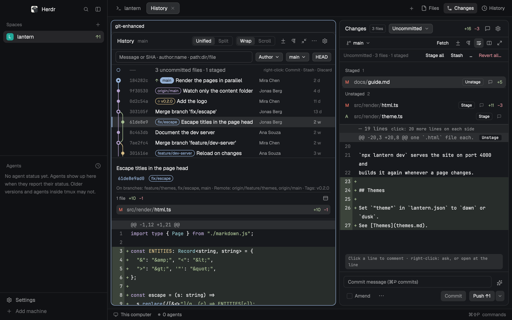

# Git Enhanced

A git panel for Herdr on the repository of the terminal you're in, on this computer or on an SSH
machine. The Changes page lists what changed with the open file's diff: stage files, hunks or single
lines, commit and amend (an agent can write the message), push, pull, switch branches, stash, undo,
and send comments on diff lines to the space's agent as a review. A Review tab shows a change full
width, History draws the commit graph with menus down to an interactive rebase, and every agent turn
is recorded, so you can see what it changed or take it back.



This file is the brief: enough to build Git Enhanced from an empty folder. The files next to it are
one build of it. If they don't work on your Herdr, or you want it different, build it again from
here.

## What you see

Every color is the theme's: its surface, raised, popover, selected and hover backgrounds, border,
foreground, muted and dim text, accent, solid and blocked colors, and ANSI red, green, yellow, blue,
magenta and cyan. A status or code color under 4.5:1 where it is drawn (win98's green on its silver)
is drawn in the foreground, its letter or words still saying what it is. Hints are dim, muted on
raised or selected backgrounds.

Icon buttons (the gears, ±, ¶, Wrap, Split, ⤢, ⤡, ⋯, the pen, History's layout button) have
no frame: 24 px, radius 6, a 14 px muted icon, the hover background under the pointer, the selected
one while on (¶, Wrap, Split, a button whose menu is open), 2 px apart; a screen reader hears each
as a button named by its tooltip or a label of its own. A button's menu opens at the button: under
it, 3 px off, right edges lined up (Pull ▾: left edges; the commit bar's above it when there is
room), and a menu that follows from one of its items opens against the same button; while it is open
the button stays lit, without a tooltip, and a second press closes it. A right-click menu opens at
the pointer. Every close is Herdr's close icon (✕); every box that opens a list ends in its 12 px
chevron (▾).

### The Changes page

A card the block's size (rounded 10 px, the surface, a 1 px border, 13 px text):

1. **Header**, 42 px: "Changes", a file count chip, the scope box (24 px, the only part that
   shrinks), `+N` and `−N` (ANSI green, red), **Ask about diff** (with drafts, **Discard** and
   **Submit review · N**, solid), the gear. Under 600 px Ask about diff is a speech-bubble icon.
2. **Bar**, 30 px: the repository switcher (with several repositories), the branch box (a branch
   icon, the branch or "detached HEAD"), **Fetch** (with a remote), **Pull ↓N ▾** (when the
   upstream is ahead), then ± ("10" or "∞" beside it when not 3), ¶, Wrap, Split and ⤢
   (Herdr's split-right and zoom icons).
3. **Lines when needed**: "Not read: its git config has settings beyond the usual ones" with **Read
   it**; for 30 minutes after a turn's revert, "Reverted pi's turn 14:03–14:07 (3 files)" with
   Undo and ✕; while a merge, rebase, cherry-pick, revert or git am is stopped, a 30 px bar on the
   blocked color at 12%, "Merge stopped: 1 file conflict" ("(commit 2 of 5)" in a rebase; a git am
   whose patch didn't apply says so), with Continue, Skip… (not for a merge), Abort… (ANSI red)
   and, while files conflict, Ask an agent… (an icon under 600 px).
4. **Action bar**, 32 px: "Uncommitted · 3 files · 1 staged" (inner repositories counted apart,
   never as files), **Stage all** (or Unstage all), **Stash**, **…**, **Stashes · N ▾**,
   **Revert all…** (ANSI red); for a read-only scope a "read-only" chip, what is shown,
   **Uncommitted** and, for a turn, **Revert this turn…**.
5. **File list**, up to 260 px tall (320 in the Review tab): Staged, Unstaged or Committed with
   counts, then 28 px rows: the letter (A ANSI green, D and U ANSI red, others the blocked color),
   the folder dim, the name (`old → new` for a rename), a comment bubble with the drafts' count,
   Stage or Unstage, `+N −N`; the open row selected; 100 rows a section, then "Show 100 more ·
   1,234 left". A repository inside this one is `sub/` with a dim "repository".
6. **The diff**, the rest: the terminals' font at the Code size (12 px; Terminal: their size less
   one, 9 at least), rows 1.8 times that; `@@` rows raised, with **Stage** and **Revert…** (or
   **Unstage**); added and removed rows tinted ANSI green and red; both line numbers; token colors;
   comment cards under their rows (an accent border); "⋯ 12 lines" rows between hunks. One column
   or old | new side by side, long lines wrapped or scrolling sideways with the numbers and buttons
   staying. At the bottom right: "Click a line to comment · right-click: ask, or open at the line".
7. **In the diff's place**: an image's Before | After with pixel and file sizes; a stash's changes
   (Apply, Pop, Drop…, ✕); for an inner repository "sub/ is a git repository of its own inside
   this one. Its changes are in that repository." with **Show its changes**; the conflict view: a 40
   px bar (the path, "1 of 3 conflicts chosen", Show base…, **Save** or **Save, resolved**, ✕)
   over a card per block, bordered in the blocked color until chosen: "Conflict 2 of 3 · line 14",
   chips Ours, Theirs, Both, Both, theirs first, Base and Keep (the chosen one bordered in the
   accent), the sides tinted ANSI blue (ours), dim (base) and ANSI magenta (theirs), 40 lines each
   at most.
8. **The comment box**, 300 px over the diff's top right (docked under it below 600 px): "Comment",
   ?, ✕, the lines, the text, for changed lines **Stage lines** and **Discard…** or **Unstage
   lines**, then Cancel and **Add comment**.
9. **Commit bar**, sized as Herdr's tab bar (26 px): the message box (1 to 6 rows; an accent border
   while typing) with the pen (sparkles; "Writing…"), **Amend**, ⋯, **Commit** (solid), **Push
   ↑N** or **Publish** with ▾. Over it, what failed (ANSI red) and Commit's questions (the
   blocked color). Under 600 px the box has a row of its own.

**The Changes | History switch**: in a layout block where nothing else leads to History (no tab
header of this mod over its stack, no History page of its own), the page's name is a segmented
control, "Changes | History" (the shown one on raised). It has no row of its own; History's top row
is as tall, so it stays put. Under 470 px it takes the file count chip's place.

**The Review tab**: the Changes page full width in a tab; its header adds Unified | Split, Wrap |
Scroll, ±, ¶ and "2 / 5 viewed"; each file has a Viewed box (a viewed row at half opacity);
changed words are marked within a pair of lines; ⤡ (Herdr's unzoom icon) goes back.

### The History page

A card as the Changes page:

1. **Header**, 42 px: "History" (or the switch), the repository switcher, the branch, in a tab the
   two switches; then ±, ¶, Wrap and Split (in the panel), ⤢ or ⤡, ⋯ and the gear.
2. **Filters**, 38 px (two rows under 560 px): the search field, **Author ▾** (each person with
   "12 listed"), the branch menu (`main ▾`, `All branches ▾` or a branch; Current branch, All
   branches, then up to 60 branches by their last commit, one checked out in another worktree saying
   where) and **HEAD**.
3. **Lines when needed**: an action or why it failed (ANSI red); a stopped operation, "A rebase
   stopped. Resolve the conflicts in Changes, then Continue or Skip there, or abort it here." with
   **Abort rebase**; bisecting, on the accent at 10%, "Bisecting · testing 1a2b3c4" with Good (ANSI
   green), Bad (ANSI red), Skip and Reset, then "The first bad commit is 1a2b3c4" with Show it;
   after a slow page, "Large history without git's commit-graph: every page reads all of it." with
   **Write it** and ✕.
4. **The commits**: one-line rows, 26 px (lanes, the hash 58 px, labels and subject at least 160,
   the author 130, the age 46), else two-line rows, 40 px. Lanes are 1.5 px paths in ANSI blue (the
   current branch), magenta (its upstream), then green, yellow, cyan, red; dots 4 px, HEAD's ringed,
   a merge's hollow; ↑ (ANSI green) not pushed, ↓ (ANSI yellow) not pulled; labels as chips
   (branches blue, remote branches magenta, tags yellow with ◇, the current branch filled),
   clipped before the author. First "3 uncommitted files · 1 staged" (a hollow accent dot), last
   "Load 300 more". Between subject, author and date a 7 px line shows under the pointer. The date
   reads "2 d"; from 100 px "2025-03-14 09:30"; from 140 px both.
5. **The selected commit**, beside the list (42% of the width) or under it (38% of the height), with
   a line between to drag: its information (40% of its height) in two parts that scroll on their
   own, the message (the subject, **Show full message** for a body, people, dates, parents and
   labels as links, "On branches: … · Remote: … · Tags: …") and the files ("1 file +1 −0"
   with the layout button at its end, over 24 px rows, at most half the area); then a second line
   and the clicked file's diff, read-only.

### Menus, dialogs, the tab header, the settings window

- **Menus** are popups as tall as their rows (30 px, 42 with a second line), 220 to 340 px wide; the
  commit menu has 26 px rows under its subject (two lines at most). Worktrees… and Remotes… past
  12 rows are a 520 × 560 dialog that scrolls, each row with ⋯. A menu of settings checks the one
  in use.
- **Dialogs** are 460 px wide by default (the rebase editor 680 by up to 640, the send dialog up to
  680 × 560): a title, the words, as needed lines, files to tick, a field, tick boxes or choices,
  then Cancel and the confirm button (solid, or ANSI red when it throws work away). The send dialog:
  "Ask the agent" and what is asked about, "To" and the agent (a status dot, "Claude Code · api
  (idle)"), the note, "Goes with it (3 KB)" with Copy over the context in the code font, Cancel and
  Send.
- **The tab header**, over the panel's pages where a layout puts it, 34 px: 26 px tabs, each Herdr's
  file, changes or clock icon and its title in 12 px muted text, the shown one selected. No gear.
- **The settings window**, 640 × 560 on the popover background, one at a time whichever mod opens
  it, where it was last dropped: a 40 px title bar ("Git settings", ✕), the tabs Git, Open with
  and Agents, the page scrolling, a 44 px foot (Reset this section, Reset all, "Saved as you change
  it"). Each row: a 13 px title over a muted line, its control at the right (a 32 × 18 toggle,
  accent when on; segmented choices; a − value + stepper; a drop-down floating over the rows
  below; a text field). Git: Diffs (ignore whitespace, context lines, Code size 11 to 14 or
  Terminal); Repositories (folders down to look, 0 to 4; automatic fetch, never to every hour);
  Committing (the two questions; Commit messages written by pi, Claude Code, Codex, OpenCode or Your
  own command, each "found" or "not found here"; the model, `provider/model`; what a new message
  starts with; and "The pen sends the diff, the staged and new file names, and recent commit
  subjects to the program you pick (and through it to its provider)."); Agent turns (on, 10 to 500
  kept). Open with: what a double-click, Open ↗ and Open at a line use, the menus' programs
  (ticked, ↑ ↓), Add your own…. Agents: the one started when a space has none, and where. With
  Files Enhanced installed these two start "Files Enhanced and Git Enhanced both use these."
- **The window** (⌘⌥G): the Changes page, 760 px wide and 85% of the window's height, under a 32
  px bar with Changes | History and ✕.

## How it behaves

### What it shows

- It follows the focused pane's folder, on the space's machine; with more repositories below it (to
  the settings' depth, 50 at most), the most recently changed one or the switcher's pick for that
  folder ("Couldn't read 1 of them just now: git didn't answer" when one doesn't answer). Review and
  History tabs stay on their repository.
- A repository found below the folder is read only when its own git config holds only settings git
  writes or plain preferences, or after **Read it** (that config trusted; a change asks again). The
  folder's own, and an agent's for its turns, are always read; only those and trusted ones fetch by
  themselves. Git run on its own gets no fsmonitor, hooks, external diff or textconv; what you ask
  for runs as in a terminal, hooks included.
- Every copy reloads after any action; a repository here also on folder changes and every 10 s, one
  on another machine every 4 s (History every 10 s). There, without base64 or openssl, hunks get no
  buttons, and staging lines and the conflict view's Save say why they can't.
- **Scopes**: Uncommitted, Last commit (with what is uncommitted), vs main (since the branch left
  main or master), and read-only A commit…, Compare with… (a branch, tag or commit against the
  working tree) and An agent's turn…, their lists filtering as you type; each repository keeps its
  own.
- Empty: "No uncommitted changes", "No differences", "Reading the changes…", "Not a git
  repository"; past 1,000 files, "Showing the first 1,000 changed files". Busy: the action's button
  says it ("Pushing…"), the others are muted, and one asked for meanwhile says "Busy (Fetching):
  try again once it's done".
- **Agent turns**: when an agent starts working in a repository a turn begins, a snapshot of the
  working tree (new files too) that never touches the index, branches or files; done or idle (or
  gone) ends it with a second; blocked keeps it open; one left open by a restart ends at the next
  look; a snapshot over 10 s marks the turn skipped. Only the panel's Changes page records. An
  agent's turn… shows what one changed; Revert this turn… lists what happens to each file, then
  puts them back (the index untouched); Undo takes that back.

### On the Changes page

- **A file row**: a click opens its diff (again: closes it); the first opens by itself. Stage or
  Unstage on the row; the bubble comments on the whole file. Right-click: Revert changes… (a new
  file: Delete file…), and Show in Files with Files Enhanced installed; a conflicted file: Resolve
  the conflicts…, Start over…, a Take… for each side (named as the operation has it, as "Take
  main…" or "Take The picked commit 1a2b3c4…"; ": deleted" when that side deleted the file),
  Delete the file…, Mark as resolved (asks while markers are left); an inner repository: only
  Stage it as an embedded repository…, which asks first (a submodule or `.gitignore` is usually
  what's meant), and its page's Show its changes switches this page to it (the Review tab opens a
  Review tab for it). Stage all and staging everything leave inner repositories out, saying so once
  under the diff. The list shows down to the open file (n/p, a reveal) even past 100 rows; another
  repository or scope starts again at 100.
- **A diff row**: a click starts a comment (a second click takes in the rows between); a card's
  click edits it. A hunk's buttons act on it alone (none while whitespace is ignored). With changed
  lines among the rows, the box's Stage lines, Unstage lines and Discard… (asks; a copy is kept)
  act on those lines; rows that moved since say "The diff changed since these rows were selected:
  select them again". "⋯ N lines" shows 20 more lines each side. Right-click: Ask about line
  12…, Open at line 12 (the Open with program for lines, over ssh on another machine), Blame line
  12 (who and when, Show the commit, Blame before this change, Copy the hash).
- **Comments** wait as drafts per repository and scope. Submit review sends them as one message, Ask
  about diff the open diff, Ask an agent… the conflicts, each through the send dialog: to the
  agent picked, else the focused one, else an idle one, pasted into its terminal, the agent brought
  up; "Send anyway" first for a working or blocked one; with no agent in the space, the settings'
  agent starts with the text as its first message.
- **Commit** takes what is staged; with nothing staged its first press says "Nothing is staged.
  Commit again to stage every change and commit it." ⌘↩ commits once per press; Enter is a new
  line; an empty box starts with the template. **Amend** brings back the last message, and a pushed
  commit asks first. **The pen** has the chosen agent write a message from the staged diff (else
  every change), the new files and the last subjects, filling the box only; its right-click picks
  another agent installed here. It always runs here, 20 s at most for pi, 60 s for the others.
- **Push ↑N**, or **Publish** without an upstream; ▾: Sync… (a pull that rebases, keeping
  merges, then a push; asks), Publish, Force push (with lease)… (asks; refused when the remote
  moved or has commits fetched but never in the branch), Push every tag. **Fetch** prunes. **Pull
  ↓N ▾**: fast-forward only (off when diverged), rebasing (asks if the branch has commits of its
  own) or merging, uncommitted changes stashed around it.
- **Stash** puts everything away, new files too; **…** asks a message and what (everything, the
  staged changes, some files; keep the staged ones; ignored files too). **Stashes · N**: a click
  shows one; Apply, Pop, Drop…, and ⋯ with Apply (staged as it was), Branch from it…,
  Rename…, Compare with working tree; Drop all N… at the end.
- **⋯ by Commit**: Undo last commit (back to staged; asks when pushed, a merge or the first), Undo
  last git action… (from HEAD's reflog), Move my unpushed commits to a new branch…, Copy changes
  as patch ▸, Apply a patch… (the clipboard's; email patches become commits), Recently
  discarded… (the last 50 copies; Restore… says what it overwrites), Settings….
- **The branch box**: New branch…, Back to the previous branch, Clean up branches… (merged or
  upstream gone, ticked; never the current branch, the base, main, master, develop or trunk; those
  git keeps go by force only after asking), the branches with ↑ ↓ or "gone", the remote branches
  (60 at most); a click switches. One checked out in another worktree says "Checked out in
  ~/wt/feat" (or "Being rebased in…"), and a click goes to that worktree's space, else opens one;
  "· folder gone" asks to forget it. Right-click: Rename…, Delete…, Merge into main…, Rebase
  main onto it…, Fast-forward to its upstream, and with options Merge into main ▸ (fast-forward
  only, a merge commit, squash, without committing) and Rebase main onto it ▸ (autosquash,
  autostash, stacked branches moved along on git 2.38 or newer); a remote branch whose local branch
  is checked out elsewhere says where too; for one checked out elsewhere, Go to its worktree first,
  Fast-forward there, Delete… removing or detaching that worktree too, in one question, and
  Rename… waiting while a rebase or bisect runs there.
- **Conflicts**: Continue goes on with no editor, asking first when staged files still hold markers;
  Skip… (git 2.23 or newer for a cherry-pick or revert) and Abort… ask first. In the conflict
  view a click picks a block's choice; Save writes the file (refused if it changed meanwhile) and,
  every block chosen, marks it resolved.

### On the History page

- A click selects a commit, j/k or ↓/↑ move it; ⌘-click and ⇧-click select several, to
  cherry-pick (oldest first; -x or without committing), revert (newest first) or copy as email
  patches. The search takes words, a hash, `author:"name"`, `path:dir/file` (followed through
  renames) and `branch:name`, which Author ▾ and the branch menu write; a search draws no lanes.
  HEAD selects HEAD's commit.
- **A commit's right-click**: its labels, each a menu (a branch: check out, merge, rebase onto,
  push, set upstream, rename, delete; a remote branch: check out, fetch, delete there, asked twice;
  a tag: what it is, push, delete; one checked out in another worktree: Go to its worktree); Create
  branch here…, Create tag here… (annotated or not, or Move a tag here…), Create worktree
  here… (opened as a space, its agent started if ticked); Checkout commit…, Cherry-pick onto
  main…, Revert…; Reset main to here › (Soft, Mixed, Hard, which asks twice); Interactive
  rebase › (Reword…, Squash into parent…, Drop…, Interactive rebase from here…); Show in
  Changes, Compare with working tree, Compare with the selected commit; Open on GitHub (GitLab,
  Bitbucket…); Copy SHA; Copy › (message, patch, email patch).
- Rewriting a commit a remote branch has waits for a tick ("It is pushed: I know its history then
  differs from the remote's"). The rebase editor lists the commits oldest first with an action each
  (p r s f d), Alt+↑/↓ moving a row, and a message box wherever git will ask; a rebase refuses
  with uncommitted changes, and one that stops leaves the stopped bars.
- The uncommitted row's right-click: Commit…, Stash…, Discard all…. A commit file's: Show in
  Files, and Open this version (its text at that commit, up to 4 MB, in the system's default app).
- **⋯**: Worktrees… (open as a space, lock, move, remove, which names the ignored files deleted
  with the folder and closes the space in it first; forget the missing; clean up the merged,
  ticked), Remotes… (fetch, URLs, where pushes go, rename, remove, add), Reflog… (an entry as a
  branch, the branch moved there, a detached checkout, the hash copied), Fetch every remote, Bisect
  (the selected commit is bad), Fetch origin and prune tags… (git 2.17 or newer).
- The layout button: Automatic (side by side from 760 px), Side by side or Stacked, for every copy.
  Both lines drag, kept per copy and arrangement; the column lines resize the author (48 px at
  least) and the date (34) (the panel and the tab their own; a double-click restores them; wide ones
  give way where the list is narrower). Write it writes git's commit-graph file, as git gc does; ✕
  hides that line for the repository.

### Tabs, the window, other mods, safety, keys

- ⤢ shows the tab already open for that repository in this space, else opens one, and hides the
  panel holding the page; ⤡, or closing the tab another way (✕ in its header, ⌘W), shows the
  panel on that page again (under a block's switch, still on History). The switch starts on Changes
  for the session; the Changes page stays alive under History and comes back when asked to show a
  file or a scope. ⌘⌥G again closes the window, which drags by its bar; its Changes page doesn't
  fetch or record turns. A click on a tab of the tab header shows that page.
- **Requests from other mods** (Files Enhanced's Show changes, File history, Folder history): the
  copy showing that repository takes it (the panel's before a tab), else the panel's page switches
  to it when its switcher lists it, else a Review or History tab opens on it. Changes opens the
  file's diff (unstaged, else staged; from a read-only scope, back to Uncommitted); History puts
  `path:<path>` in its search; with no History page, a block with the switch shows its History. The
  page comes forward; requests older than 15 s are let go. Show in Files selects the file in Files
  Enhanced's tree.
- Whatever throws work away or rewrites history asks first; a revert keeps a copy (⋯ → Recently
  discarded… restores it; when none can be kept it asks again); a hard reset and deleting a remote
  branch ask twice.
- The settings window: the gear (Changes, History) opens it at Git, or closes it when open;
  Settings… only opens it; Files Enhanced's gear puts its own window in its place. A change is
  stored at once, a text field's 450 ms after the last key. Reset this section and Reset all wait
  for a second press within 3 s ("Press again to reset"; Reset all says it resets Git, Open with and
  Agents, for Files Enhanced too when installed). Esc closes a drop-down, leaves a field, closes the
  form, then the window. It looks for the programs once and on Check again. Your own command is
  split like a shell; one with an open quote isn't saved, its note saying why. Add your own… takes
  a command with `{path}`, `{file}`, `{folder}` and `{line}`; an app's command for a file on another
  machine must hold `{host}` (that machine's ssh target), and an app without one isn't offered
  there, while a pane program runs there by itself.

| Key | Where | What |
| --- | --- | --- |
| ⌘↩ | Changes | Commit, once per press; in the comment box, add it |
| Enter, Shift+Enter | the comment box | add it; a new line |
| Esc | Changes, dialogs | leave the message box, close the comment box; close |
| j / k, n / p | the Review tab | next / previous hunk, file |
| s / u / r, v | the Review tab | stage, unstage, revert the hunk; Viewed |
| j / k or ↓ / ↑ | History | move the selection |
| p r s f d, Alt+↑ / ↓ | the rebase editor | set the action; move the row |
| ⌘⌥G | anywhere | the window |

## Built from

- **The entry**: `mods/git-enhanced/` and `keys.json` (`cmd-alt-g` → `mod.open:git-enhanced`,
  `global`); based on Herdr's shipped changes mod (Apache-2.0): its refresh, file list, diff, commit
  row and read flags. `mod.json` docks it nowhere (a layout block points at it; `mod.open` opens the
  window):

  ```json
  { "place": "none", "title": "Git Enhanced",
    "overlay": { "kind": "window", "width": 760, "height": 0.85 } }
  ```

- **Parts**, chosen by `main.js` from a copy's props: `role` `tabs`, `settings`, `send`
  (paneltabs.js, settingsview.js, send.js); `question` (question.js: every menu and dialog);
  `commitMenu`, `commitAsk`, `commitName` (commitmenu.js); `rebaseEdit`; `turnRevert` (turnrec.js);
  `view: "history"` (historypage.js, history.js; with `root`, `on` a History tab); only `overlay`
  (window.js); else the Changes page (changes.js; `review: true` with `root`, `on` the Review tab),
  a layout block's wrapped by block.js, which reads `layout()` at every render for the switch.
- **Props**: `palette` (`"theme"`; else `"one-dark-pro"`, the default, or `"dark-plus"`; a light
  theme, foreground darker than surface, always gets the theme's ANSI colors), `view`, `font_size`
  (over the Code size), `commit_model` (the pen's model when the settings have none), `base` (the
  branch scope's base); the tab header's `stack` (default `panel-body`) and `icons`
  (`{ "<child id>": "<svg path>" }`).
- **In a layout**: in Herdr's own layout (`main`) and its clones, set only the content of the
  `changes` block in the `panel` column's `panel-body` stack, adding nothing: its tab bar's Changes
  button selects that id, History is behind the switch. A stack with no other way between its pages,
  or whose row of tabs this replaces, gets the header and a `history` block (pages with a `title`;
  no switch then); blocks of other mods there get `"mod": "git-enhanced"`, ids and props kept;
  without a panel, any block. Shipped layouts are read-only (edited in place, one moves to
  `<name>-edited`): `herdr-app do layout.clone '{"name":"main","as":"my-main"}'` first. The
  herdr-enhanced entry's tab bar has a History button. herdr-t3 as published has no panel; in one
  given a panel (a `panel-body` stack), its `changes` and `history` blocks get
  `"mod": "git-enhanced"`, ids, titles and props kept, the stack's header can be ours, and its own
  panel toggle keeps showing the panel.

  ```json
  { "id": "changes", "type": "block",
    "content": { "mod": "git-enhanced", "props": { "palette": "theme" } } }
  { "id": "history", "title": "History", "type": "block",
    "content": { "mod": "git-enhanced", "props": { "palette": "theme", "view": "history" } } }
  "header": { "content": { "mod": "git-enhanced",
              "props": { "role": "tabs", "stack": "panel-body" } }, "height": 34 }
  ```

- **herdr**: `exec` (git, sh, find, with `on` for a machine; agents and openers here),
  `readTextFile`, `watchFolder`, `appHome`, `home`, `theme`, `settings`, `props`, `shared`,
  `setShared`, `openOverlay`, `closeOverlay`, `notify`, `nextCommand`, `agents`, `spaces`, `panes`,
  `focused`, `layout`, `window`, `hc` (`send`, with `--force` for a busy agent; `machine ls`), `run`
  (`tab.new`, `tab.select`, `tab.close`, `layout.select`, `layout.show`, `layout.hide`, `space.new`,
  `space.select`, `space.close`, `terminal.open`, `agent.focus`); `fs/promises`, `buffer`.
  gpui-base: `v_virtual_list` (the diff, the commits, a commit's files), `Popover`, `TextareaState`,
  `InputState`, `Scrollbar`.
- **Programs**: `git`; POSIX `sh` scripts (scripts.js: base64 decoded by base64 or openssl, a
  watchdog for time limits, a status checksum; mktemp, wc, tr, cksum, od, sleep, kill; no perl, no
  timeout(1)); `find` for the scan; the pen's agent in an empty temp folder here
  (`pi -p … --thinking off`, `claude -p`, `codex exec --sandbox read-only`, `opencode run`, or the
  person's command, `{prompt}` and `{model}` filled in); the system's opener (`open`, `xdg-open`; on
  Windows its file manager, rundll32 for web pages); the Open with programs.
- **Shared keys**: `git-enhanced.settings`, `herdr-enhanced.open-with`, `herdr-enhanced.agents`
  (only what differs from the defaults); `herdr-enhanced.trusted` (`"<machine>:<folder>"` → a
  config fingerprint); the mod's own (`id.js` `KEY`): `.layout`, `.lines`, `.viewed`, `.repo`,
  `.turns`, `.changed`, `.drafts`, `.scope`, `.sent`, `.show`, `.reveal`, `.tabs`, `.titles`,
  `.historyLayout`, `.historySplit`. The settings window's overlay key: `herdr-enhanced-settings`.
- **Reveal**: `setShared("git-enhanced.reveal", { at: Date.now(), root, on, path, page })` (`page`
  "changes" or "history"); reveals.js makes the same choice of copy in every copy. Show in Files
  sets `files-enhanced.reveal` to `{ at, full, on }`. The asking side brings the page forward too
  (`layout.select`, `layout.show`).
- **Writes**: the repository through git only; `refs/git-enhanced/turns/<id>/start`, `/end`, `/undo`
  (commits by `git-enhanced` on a copied index, pruned to `turnsKeep`) and
  `refs/git-enhanced/discarded/<ms>` (the newest 50); the reflog mark `[git-enhanced undo]`;
  worktrees in `~/.herdr/worktrees/<repository>/<branch>`, as Herdr's own dialog makes them;
  `cache/git-enhanced/` in the app's folder: image copies and
  `at-<commit>-<8 hex of the path>-<name>` (the newest 20 of each).
- **Art**: its own SVGs, Lucide's message-square, pilcrow, diff (±) and sparkles; check, git-branch
  and plus (Lucide, from Herdr's workspace-chrome); Herdr's `changes.svg`; `wrap.svg`,
  `layout-side.svg`, `layout-stacked.svg`. By path: `mods/workspace-chrome/` `settings.svg`,
  `x.svg`, `chevron-down.svg`, `clock.svg`; `mods/files/file.svg`; `mods/changes/changes.svg`;
  `mods/pane/` `zoom.svg`, `unzoom.svg`, `split-right.svg`.
- **Shared with Files Enhanced**, copied unchanged from the repository's `shared/`: the tab header
  (`paneltabs.js`), the settings window and its pages (`settingsview.js`, `openwithview.js`,
  `controls.js`, `fields.js`, `openlist.js`, `openwith.js`, `panelsettings.js`, `shellwords.js`,
  adapted from shell-words, MIT), the send dialog (`send.js`), the reveal keys (`reveal.js`,
  `weakcopies.js`), icon buttons and menu placement (`iconbutton.js`, `menuat.js`), the trust check
  (`gittrust.js`, `repotrust.js`), `ink.js`, `installed.js`, and pages in tabs (`tabs.js`,
  `tabplace.js`). They import only each other and `./id.js` (`ID`, the folder's name; `PART`).
- **Adapted**: the lanes from VS Code (MIT); undo's reflog walk, renames in `git status -z`,
  conflict markers and line staging from lazygit (MIT); two git settings for a turn's private index
  from Cline (Apache-2.0).

## Watch out

- Herdr reloads a mod in place when its files change: copies get new objects without `close()`, and
  old modules stay in the memory all mods share (256 MiB; about 3 MiB per reload): hold module-level
  sets of copies weakly (`weakcopies.js`).
- Code runs in calls (a click, a timer, an exec's result), each a copy's, and what a call starts
  dies with its copy. A question is a copy of its own, its answer arriving in its call: take it with
  a timer the page starts when it asks (`onpage.js`), or the flow stops with the dialog.
- `cx.notify()` and `setShared()` throw during a render (use `cx.timer.after(1, …)`); an event's
  `cx` is good only during it; a handler inside a virtual list's row throws (use `on_item_click` and
  `on_item_secondary_click`; History's labels have their menus in the details and the commit menu).
- A scroll area needs a definite height (`h(…)`, or `flex_1().min_h(0)` in a sized parent); lists
  in popovers get it from fixed row heights (`ui.js` `listCard`). A popup is as tall as what it
  holds: a root that scrolls shows as a 2 px line, so menus are fixed rows with a computed height.
  An `h_flex` leaves a virtual list 0 px tall unless the row has `items_stretch()`. The test stubs
  flag both (`test/shared/layoutlint.mjs`).
- Herdr stops a render that runs too long, and every row shown is built on every render: 100 file
  rows at a time, a commit's files in a virtual list. Inside `h_resizable` / `v_resizable` the diff
  can't scroll: History's lines are strips taking the press, the size kept when it ends or the
  pointer leaves.
- A tooltip is built from the frame its hover began in: one that changes needs an id naming the
  state. Herdr zooms a popup's size, not its `at` (`menuAt` multiplies by `settings().zoom`). One
  press can arrive twice and held keys repeat: Commit takes a press only after the key went up and
  150 ms passed. `settings()` calls the terminals' font `font_family`, not `font`.
- `exec` gives up after 30 s by default: the pen gets its agent's limit plus 15 s, commits and
  network 120 s, a rebase 180 s, a worktree 10 min, a snapshot 40 s. It has no stdin: bytes go as
  base64 arguments of 98,304 characters, in all under the machine's `ARG_MAX` (1 MB at most, 600 KB
  when unknown). `dash` has no job control without a terminal: the watchdog stops the job itself,
  its messages on fd 3.
- Copy the index with `cp -p` (a fresh mtime makes every file look changed). `git rev-parse @{u}`
  prints `@{u}` and fails without an upstream. An upstream can be a local branch (`%(upstream)` is
  `refs/heads/main`): show it as `main`; its label's Push is "Publish to origin…", asked first.
- A `.git` isn't always a repository (GitKraken leaves a `.git` folder with only `gk/` in it): the
  scan's `find` keeps a folder with a `HEAD` and a file starting `gitdir: `
  (`-exec sh -c KEEP sh {} +`), skips `node_modules`, stops after 4 s. The switcher reads all
  repositories in one exec (6 s at most): one git didn't answer for keeps its last branch rather
  than a blank row.
- A rebase takes its list through `GIT_SEQUENCE_EDITOR` and its messages through `GIT_EDITOR` (the
  commit asked about is the one named on the done list's last line), and refuses with uncommitted
  changes (never stash silently). Continue runs `git <op> --continue` with no editor (a merge on git
  before 2.12: `git commit`). History reads again when the refs or the search move, but a stopped
  merge, cherry-pick or revert moves no ref: put what stopped in that signature. A commit menu's
  cherry-pick runs in the menu's copy: the page hears of it by the `changed` key.
- Stage all leaves inner repositories out with `git add -A -- :/ ':(exclude,literal)sub/'`: no
  `--literal-pathspecs` there, and `literal` keeps spaces, a leading `-`, `*` and `?` as they are.
- A worktree whose folder is gone keeps its branch until `git worktree prune`, which skips a locked
  one (its folder looked for by `worktrees.js` `MISSING_SH`): forgetting that one takes
  `git worktree remove -f -f`. A rebase or bisect in another worktree keeps its branch though git
  lists that worktree as detached (`BUSY_SH`, run only for detached ones). Removing a worktree is
  forced when it has changes, untracked files or a lock, all read before its one question; changes
  that come meanwhile, or git refusing for a submodule, ask once more, and the space in it closes
  first, with its terminals (`wtremove.js`, as Herdr's own worktree mod does).
- Limits: 1,000 changed files; 1,500 diff rows, lines cut at 4,000 characters; a new file read up to
  400,000 characters; 300 commits a page; 60 commits and 200 refs in the scope lists; the pen's
  12,000 characters of diff and 100 new names; images from another machine up to 2.5 MB; Open this
  version, text up to 4 MB.
- The name is written once, in `id.js` (`FOLDER`): renaming the folder means changing that line
  (Herdr's `mod.clone` does) and the layout's `mod` names, and loses Files Enhanced's links to it.
- The settings window is a window overlay: a press its controls don't stop drags it (`controls.js`
  `own`); it focuses its handle, again 300 ms later; Herdr's `close()` saves the text that waits. It
  and the tab header are the same files in both mods: change them in `shared/`
  (`tools/copy-shared.mjs`). Tests never start an editor, opener or agent (a real `zed` opens files
  in the person's Zed): the stubs answer.

## Done when

- `herdr-app check mods/git-enhanced` passes, and each of these opens and shows in full: the
  questions, the commit menu and dialogs, the rebase editor, the send dialog, a turn's revert, and
  History wide, narrow, in a tab, with the uncommitted row and with the filters open.
- In a scratch repository with a bare remote all of these work: staging and reverting files, hunks
  and lines, committing, amending, pushing, fetching, pulling, merging and rebasing, stashing,
  undo, restoring a discarded copy, recording and reverting a turn, rewriting history and making a
  worktree. The same in a space on another machine, with git running there.
- In the app: a file staged from its row shows in Staged; a hunk's Stage stages only it; Submit
  review arrives in the agent's terminal; ⤢ opens one History tab and hides the panel, ⤡ brings
  it back; a commit's menu shows in full, not as a thin line.
- With Files Enhanced: Show in Files selects the file in its tree; Show changes and File history
  open these pages on it; in Herdr's own layout File history and Folder history show the block's
  History searching `path:` there, with no new tab; History's ⋯, Open this version and Blame line
  N work there, and the block stays on its page. A cherry-pick from the commit menu that stops shows
  the stopped bars and the conflict view; aborted, they go.
- With the tab header, the stack's pages show as tabs and a click switches. The gears and
  Settings… open one "Git settings" window (Git | Open with | Agents) at Git, the other mod's
  window taking its place when opened from there; a change shows at once; each page has exactly one
  gear, also in the window; pressed again it closes it, and after ✕ or Esc the next press opens
  it.
