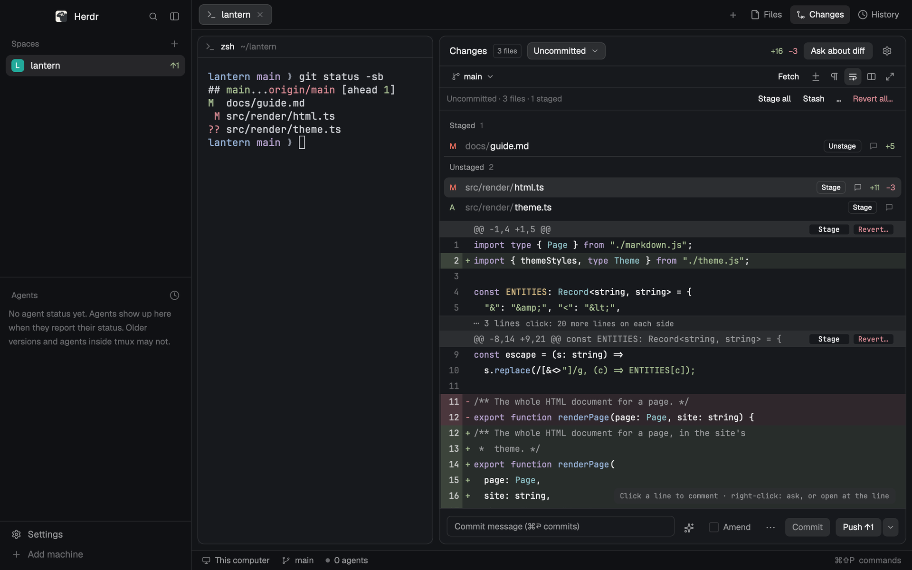

# Herdr Enhanced

Herdr's own window with a better side panel. Its tab bar has a History button beside Files and
Changes, and the three open the panel on [Files Enhanced](../files-enhanced/README.md)'s file
browser or on [Git Enhanced](../git-enhanced/README.md)'s Changes and History pages. Everything else
is Herdr's own layout, and your theme, fonts and sizes decide how it looks.



## What it does

- **Herdr's window with a better panel.** The sidebar, the tab bar, the panes and the status bar are
  Herdr's own layout as the Herdr app 0.1.15 ships it. Its panel has three pages in place of Herdr's
  Files and Changes:
  - **Files** ([Files Enhanced](../files-enhanced/README.md)): the focused terminal's folder as a
    tree with git marks, a preview that edits, search in file names and contents, a right-click menu
    with dialogs, several selected rows and a file clipboard.
  - **Changes** ([Git Enhanced](../git-enhanced/README.md)): staging files and hunks, committing (an
    agent can write the message), amending, pushing, branches, stashes, undo, comments on diff lines
    sent to the space's agent, and a record of what each agent turn changed.
  - **History** (Git Enhanced too): the commit graph, with menus down to an interactive rebase.
- **History on the tab bar.** The tab bar is a copy of Herdr's with a History button after Files and
  Changes, so History is a page of the panel and the Changes page needs no Changes | History switch.
  A button shows the panel on its page, and the lit one hides it again; each space remembers its
  page, History too. History comes with Changes: turn Changes off in Herdr's choice of panels (its
  welcome screen's "Choose your panels") and History goes with it.
- **The new-tab menu opens under the + button**, as the panel's menus open at their buttons, not
  where the pointer pressed.
- **The pages lead to each other.** A file in Files has Show changes and File history (a folder,
  Folder history): the panel shows Changes on that file's diff, or History searching `path:` it. A
  file in Changes or History has Show in Files.
- **A page in a tab.** Each page's ⤢ opens it in a tab of its own while the panel hides; ⤡ in
  the tab, or closing the tab, brings the panel back on that page.
- **One settings window**, opened by each page's gear ([Settings](#settings)).
- **Windows of their own**: ⌘⌥F and ⌘⌥G open Files or Changes over the layout
  ([Keys](#keys)).
- **On another machine too**: in a space on an SSH machine (added with `hc machine add`), every page
  works as it does on this computer.

## Install

Both mods run programs (git, sh, find and more, here or on the space's machine), and Git Enhanced's
pen sends a diff to the agent you pick: read [What it runs and touches](#what-it-runs-and-touches)
before you copy them.

```sh
git clone https://github.com/chaofanma/herdr-enhanced.git
cd herdr-enhanced/herdr-enhanced
cp layouts/herdr-enhanced.json layouts/herdr-enhanced.svg ~/.config/herdr-app/layouts/
cp -R mods/files-enhanced mods/git-enhanced mods/tabs-enhanced ~/.config/herdr-app/mods/
herdr-app check ~/.config/herdr-app/mods/files-enhanced
herdr-app check ~/.config/herdr-app/mods/git-enhanced
herdr-app check ~/.config/herdr-app/mods/tabs-enhanced
herdr-app do layout.switch '{"name":"herdr-enhanced"}'
```

Then merge the keys ([Keys](#keys)). Or ask an agent in Herdr to do it all:

```text
Read ~/.config/herdr-app/AGENTS.md, then add this layout: https://github.com/chaofanma/herdr-enhanced/tree/master/herdr-enhanced
```

Its page in Herdr's gallery: herdr.dev/layouts/chaofanma/herdr-enhanced--herdr-enhanced.

- The picture `herdr-enhanced.svg` goes with the layout: Herdr's settings screen shows it.
- Your own layout stays as it was. Ctrl+Shift+L goes to the next layout (press it until yours is
  back), or run `herdr-app do layout.switch '{"name":"main"}'` with your layout's name. Deleting the
  layout's two files and the three mod folders removes it; the mods' READMEs say what they keep
  elsewhere (settings, caches, Git Enhanced's refs).
- A name that's taken already (a layout or mod of yours with that name): rename the new one, and its
  name in the layout file. A renamed Files Enhanced or Git Enhanced still works, but the other one's
  links to it stop: they find each other by these names. Installed already from their own entries,
  Files Enhanced and Git Enhanced are the same mods: copy over them.
- To update, copy the new files and folders over the old ones: Herdr reloads what changed. Herdr
  doesn't update its tab bar's copy here: the repository's `tools/check-upstream.sh` says when
  Herdr's own changed, and the layout's copy is made again from it.
- To keep your own layout instead, put the two mods in it: their READMEs say how. Under Herdr's own
  tab bar, which has no History button, History is then a Changes | History switch on the Changes
  page.

## Keys

The layout's `keys.json` has both mods' window keys. Merge it into `~/.config/herdr-app/keys.json`,
asking first if a key is taken:

```json
{ "global": { "cmd-alt-f": "mod.open:files-enhanced", "cmd-alt-g": "mod.open:git-enhanced" } }
```

⌘⌥F opens Files as a window over the layout, 420 px wide; ⌘⌥G opens Changes, 760 px wide.
Both take most of the window's height, and the same key again closes them. The window has a slim
bar, "Files" or Changes | History, and ✕ (each page has its own gear for the settings). Drag it by
the bar; it stays where you drop it. A window's Changes page doesn't fetch or record agent turns by
itself: the panel's copy does.

Each mod's commands for keys of your own (Files Enhanced's focus and search, Git Enhanced's submit
and ask, …) are in its README.

## Settings

Each page's gear, at the right end of its top row, opens the settings window; Settings… in Files'
folder menu and in Changes' ⋯ menu opens it too (and only opens it). It is one window, whichever
page opens it: Files' gear opens "Files settings" (Files, Open with, Agents), the Changes and
History gears "Git settings" (Git, Open with, Agents), each in place of the other. Pressed while
that mod's window is open, a gear closes it (its tooltip says "Close settings" then, else
"Settings"). Open with and Agents are both mods' settings: a change in either window is the other's
too. What every setting does: [Files Enhanced](../files-enhanced/README.md), [Git
Enhanced](../git-enhanced/README.md).

The layout gives both Git Enhanced pages `"palette": "theme"`: their code is colored with your
theme's colors.

## What it runs and touches

- **The tab bar** runs no program, reads no file and makes no web request. It keeps each space's
  page in its own storage, and shows, hides and switches the panel through Herdr's commands.
- **Files Enhanced and Git Enhanced** run `sh`, `git` and more, here or on the space's machine; Git
  Enhanced's pen hands your diff to the agent you pick, which sends it to its model provider.
  Neither makes a web request of its own; git reaches your remotes when you fetch, pull or push (and
  by itself with automatic fetch set). A repository they find below the folder is read only when its
  own git config has nothing beyond the usual settings, or after you press Read it. All of it,
  program by program: [Files Enhanced](../files-enhanced/README.md), [Git
  Enhanced](../git-enhanced/README.md).

How it's built: [RECIPE.md](RECIPE.md). License: [the repository's README](../README.md#license).
