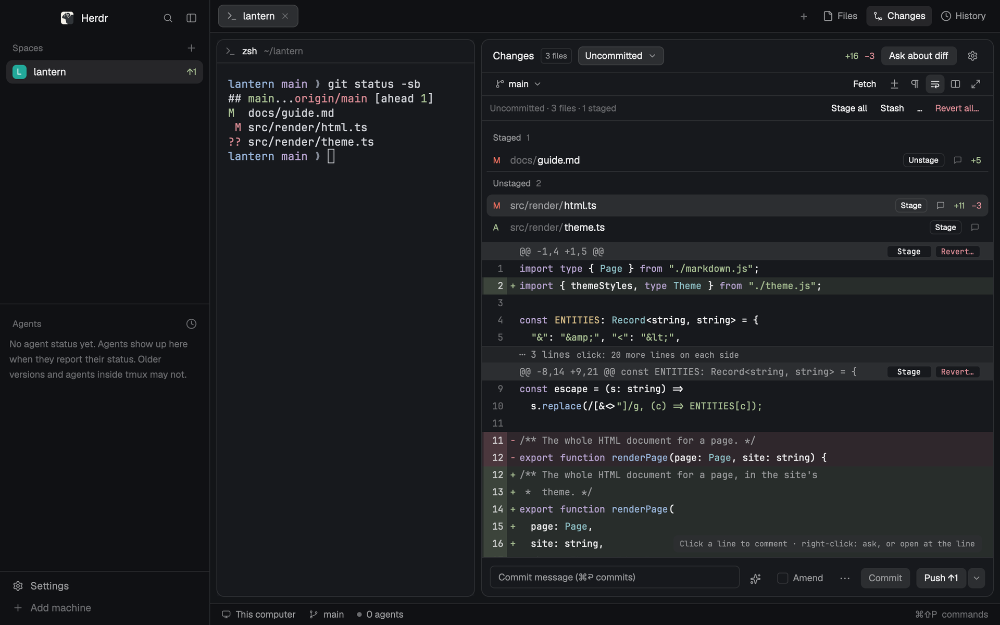

# Herdr Enhanced

Herdr's own window with a better side panel: the tab bar's Files, Changes and History buttons open
the panel on that page. Files is a tree of the focused terminal's folder with git marks, a preview
that edits, search and a file clipboard; Changes stages files and hunks, commits (an agent can write
the message), pushes, stashes and undoes, and sends review comments to the space's agent; History
draws the commit graph. Here or in a space on an SSH machine.

This file is the brief: enough to build Herdr Enhanced from an empty folder. The files next to it
are one build of it. If they don't work on your Herdr, or you want it different, build it again from
here.

## What you see

Herdr's own window, but for a History button on its tab bar and its panel's pages. With no look of
its own, the person's theme, fonts and sizes decide it. No system title bar (a Mac's window buttons
sit at the sidebar's top left). Left to right:

1. **The sidebar**, 268px (44 to 480px dragged), on the theme's chrome: the brand row (46px, drags
   the window), the spaces and agents lists (half each, 90px at least), the footer (69px).
2. **The work column**: the tab bar (42px); a row with 8px padding and gaps, the active tab's panes
   as cards (radius 10, a 1px border, the accent while focused, a 30px header) and at its right the
   panel (368px, dragged between 280 and 900px, hidden until opened); the status bar (28px).

**The tab bar**, chrome over a 1px border line, drags the window: Herdr's tabs, the `+` button, then
**Files**, **Changes** and **History**, 26px with radius 6, 12px words beside a 14px icon (Herdr's
file and changes icons, its clock for History); the shown page's on the selected background in the
text color, the others muted. On Linux and Windows its own window buttons end it.

**The panel** has no row of tabs (the tab bar's buttons are its tabs), and each page's top row ends
with a gear (tooltip "Settings", or "Close settings" while that mod's settings window is open).
**Files** is Files Enhanced's card (radius 10, the surface color, a 1px border): its header (‹, the
folder's name, its buttons), the tree with file icons and git marks, and under it the selected
file's preview (its path as breadcrumbs). **Changes** is Git Enhanced's Changes page, its name and
file count first in its top row, then the repository and branch bar, the files by section, the open
file's diff and the commit box with the pen. **History** is its History page: the commits with their
graph, a selected commit's information and its files' diffs. Each page to the pixel: the two mods'
RECIPEs. Herdr's settings screen lists the layout with a picture of this window.

## How it behaves

- **Files**, **Changes** and **History** show the panel on that page; the lit one, pressed again,
  hides it. Each space remembers its page, History too, or the panel closed (closed for a space that
  never opened it). History comes with Changes: Herdr's choice of panels (its welcome screen's
  "Choose your panels") has only Files and Changes, and with Changes off neither Changes nor History
  has a button. The panel's edge drags its width, which Herdr keeps.
- The `+` button opens Herdr's new-tab menu under itself, left edges lined up, 3px below, as the
  panel's menus open at their buttons (Herdr's own tab bar opens it at the pointer). The tabs are
  Herdr's: a working agent's tab spins a 12px spinner in the theme's working color, a blocked or
  done one has a 6px dot in that status's color, an idle one nothing; the sidebar lists the agents
  as Herdr does.
- The pages lead to each other. Files' File history and Folder history (a row's right-click menu, in
  a repository) show the panel on History searching `path:` that file or folder (for another
  repository the folder holds, History switches to it first); Show changes shows Changes on its
  diff; Show in Files, in Changes' and History's file menus, selects it in Files. Each page's ⤢
  opens it in a tab of its own (Changes': the Review tab) and hides the panel; ⤡ in the tab, or
  closing the tab, brings the panel back on that page.
- A page's gear opens the settings window at its mod's settings: Files' "Files settings" (Files,
  Open with, Agents), Changes' and History's "Git settings" (Git, Open with, Agents). One is open at
  a time: the other mod's gear replaces it, a gear of its own mod or Esc closes it. Settings… in
  Files' folder menu and Changes' ⋯ menu only open it.
- ⌘⌥F and ⌘⌥G open Files or Changes as a window over the layout, under a slim bar ("Files",
  or Changes | History, and ✕) that drags it; the same key again closes it.
- Every page follows the focused terminal's folder, on its space's machine; Changes and History show
  its repository (a switcher picks another the folder holds, and one found below it whose git config
  has settings beyond the usual ones is read only after Read it). Changes records each agent's turn,
  from working to done or idle (blocked keeps it open), as a scope to look at or take back.

Each page's own clicks, keys and menus: the two mods' RECIPEs.

## Built from

- **The files**: `layouts/herdr-enhanced.json` and its picture `layouts/herdr-enhanced.svg` go into
  the person's `layouts/`, the three `mods/` folders into `mods/`, `keys.json` into theirs (merged);
  then `herdr-app check` on each mod and `layout.switch {"name": "herdr-enhanced"}`. `README.md` and
  `preview.png` (the gallery's screenshot) stay out, as this file does.
- **The layout** is Herdr's shipped `main` (Apache-2.0) as the Herdr app 0.1.15 ships it, every node
  and field: a root `row` (`"titlebar": "none"`, `"traffic_lights": [12, 16]`,
  `"background": "canvas"`, `"terminal_padding": [14, 12]`) of the `sidebar` column (`brand`,
  `spaces`, `agents`, `sidebar-footer`) and the `work` column (`tabs`, the `work-body` row,
  `status`). `work-body` holds `main`, `content: { tab: "active", pane: { … } }` with the `pane`
  mod as each pane's header (`"lone": true`), and the `panel` column (`"hidden": true`) around the
  `panel-body` stack (`"active": "files"`, no `header`). Changed: the root has
  `"preview": "layouts/herdr-enhanced.svg"`, `tabs` shows `tabs-enhanced`, and in the stack `files`
  shows `files-enhanced`, `changes` shows `git-enhanced` with `props: { palette: "theme" }`, and a
  third block, `history`, shows `git-enhanced` with `props: { palette: "theme", view: "history" }`.
- **The tab bar**, `mods/tabs-enhanced/`, is Herdr's shipped `tabs` mod (Apache-2.0) from the same
  release, window icons and all. The top of its `main.js` says so and lists its four changes:
  1. A History button after Changes, made as Files' and Changes' are (`panel-history`,
     `mods/workspace-chrome/clock.svg`), drawn when `shared("workspace.panels")` (default
     `["files", "changes"]`) has `changes` and `layout()`'s `panel-body` has a `history` child.
  2. `syncPanel` is given the buttons' pages, `history` among them, so a space's remembered History
     (the copy's `localStorage` key `panels`) comes back; Herdr's counts a page without a button as
     the panel closed.
  3. Its Windows window buttons draw `mods/tabs-enhanced/win-*.svg`, never `mods/tabs/…`.
  4. The `+` button's press keeps the event's `bounds` (in the window); its click opens `new-menu`
     (a popup, 250×512) at `{x, y: y + height + 3 × settings().zoom}`, as Herdr zooms a popup's
     size but not its `at`. Before any press: no `at` (the pointer).

  Its `mod.json`: `"place": "none"`, `"title": "Tabs (Herdr Enhanced)"`,
  `"cloned_from": { "name": "tabs", "version": "0.1.15" }`.
- **The two mods** are copies of their own entries, whose RECIPEs build them, say what they run,
  read and keep, and how they go into the person's own layout instead. `files-enhanced` draws
  Herdr's Files card; `git-enhanced` draws Changes, with `view: "history"` History,
  `palette: "theme"` coloring code with the theme's colors. Both open their menus, dialogs and the
  one settings window (key `herdr-enhanced-settings`) as overlays of themselves; a copy with only
  `{ overlay }` in its props is the `mod.open` window (its `mod.json`: Files 420px × 80%, Changes
  760px × 85%).
- **Shipped mods:** `workspace-chrome` (brand; footer with `props: { footer: true }`), `spaces`,
  `agents`, `pane` and `workspace-status`, as in `main`; the tab bar opens `new-menu` and `menu` and
  draws icons of `files`, `changes`, `workspace-chrome` and `pane`.
- **`keys.json`**: `global` binds `cmd-alt-f` to `mod.open:files-enhanced` and `cmd-alt-g` to
  `mod.open:git-enhanced`, both mods' own entries' keys.
- **The picture**: 640×400, self-contained vector (no images, links or scripts), neutral greys, one
  accent (`#4f8cf7`) and the diff's `#3fb950`, `#f85149`, `#e3b341`: the window, agents working,
  done and idle, the panel on Changes (lit on the tab bar; two files with Stage, a diff, Commit).

## Watch out

- `mods/files-enhanced/` and `mods/git-enhanced/` are copies of the mods' own entries, made by the
  repository's `tools/make-entry.mjs` and checked by `tools/check-copies.sh`: change the mods there.
  `mods/tabs-enhanced/` is this entry's own.
- Keep Herdr's ids: its shipped mods and the tab bar find `sidebar` by id, the tab bar also `panel`
  and `panel-body`, and it selects the pages `files`, `changes` and `history` by theirs.
- No `header` on `panel-body` and no tab header of ours (`role: "tabs"`): the tab bar is the panel's
  row of tabs. With a `history` block, the `changes` block is the Changes page alone with its own
  name; without one it draws a Changes | History switch (it reads the layout at every render).
- Copy the picture with the layout: the root names it from `~/.config/herdr-app`.
- A layout of its own, never an edit of `main`, and a tab bar of its own, never an edit of `tabs`:
  Herdr replaces its shipped files on every start and moves an edited one aside (`main-edited`). Nor
  does it update a copy: when its tab bar changes (the repository's `tools/check-upstream.sh`
  compares the installed one with 0.1.15's), copy the new one in and make the same four changes.
- A name already taken: rename the new folder or file, its `mod` names in the layout and its
  `mods/<name>/` paths (a mod's `id.js` `FOLDER`, the tab bar's icons). The mods find each other by
  the names `files-enhanced` and `git-enhanced` (`installed.js` `MODS`): renamed, one still works,
  but the other's links to it stop. Installed already from their own entries, they are the same
  mods: copy over them.

## Done when

- `herdr-app check` passes for the three mods, `layout.switch {"name": "herdr-enhanced"}` shows
  Herdr's window, and the settings screen lists the layout with its picture.
- One row of tabs, the tab bar's, with Files, Changes and History after `+`; the Changes page shows
  its own name (no Changes | History switch). Files shows the focused terminal's folder as a tree
  with git marks; Changes the changed files, a click on one its diff; History the commit graph, a
  click on a commit its files and the first one's diff.
- A space left on History shows History again when you come back; with Changes off in Herdr's
  panels, neither Changes nor History has a button. The new-tab menu opens 3px under the `+` button,
  left edges lined up, at any zoom.
- File history in Files shows the panel on History searching `path:` that file, and opens no tab.
  History's ⤢ opens a History tab and hides the panel; ⤡ brings the panel back on History.
- History's ⋯ has Worktrees…, Remotes…, Reflog…, Fetch every remote and Bisect; a
  cherry-pick that stops shows History's stopped bar, and Changes the conflict view.
- Each page's gear opens "Files settings" or "Git settings" at its section, without the other mod's;
  the same gear again, or Esc, closes it. ⌘⌥G opens Changes in a window whose bar switches to
  History, and closes it again; ⌘⌥F the same for Files. Switching to another layout and back
  works.
